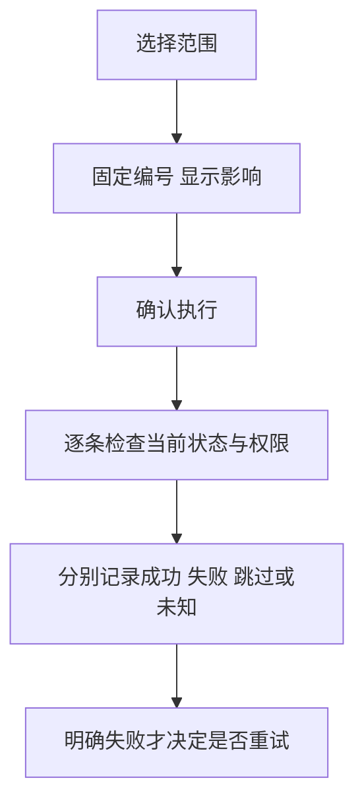

## 一句话解释

先说清选了谁，再逐条执行并交代结果。一个批次完成，不代表每条都成功。

## 适合谁看

产品、交互、设计、开发、运营和测试可先看[四幅批量操作图](#visual-guide)，再操作[批量关闭工单演示](#bulk-action-demo)。只影响本页八条虚构记录。

## 当前页和全部匹配不是一个范围

图1中第一页为 `T001–T003` 共3条，全部匹配为 `T001–T008` 共8条。手动勾选只包含明确选择的编号；“仅选择失败项”只取上批明确失败的对象。

本例翻页或改变筛选会清除选择。真实产品若保留跨页选择，需清楚显示已选范围。

“全部匹配”还需定义按哪个时刻、哪套条件选取。本例打开确认窗口时固定编号集合，之后新出现的记录不加入本批。

## 确认窗口要回答四件事

图2把动作“关闭工单”、范围“全部状态8条”、完整编号和影响一起展示。只关闭仍为待处理的记录，已关闭的跳过；取消不提交批次。

确认不等于审批。敏感操作还需独立检查[权限与审批](/articles/access-approval-audit#权限检查的四个维度)。

## 执行时重新校验

确认后对象仍可能变化。演示里的“模拟一条状态变化”使一条工单提前关闭，执行时应跳过；不能依据旧画面重复关闭。

## 八条虚构记录怎样得出批次结果

图3按默认设置，不额外模拟状态变化：

- `T001、T004、T007` 原本已关闭，跳过3条。
- `T002` 模拟处理失败，共1条。
- `T003、T005、T006、T008` 成功关闭，共4条。

合计8条。若另模拟一条状态变化，则为成功3、失败1、跳过4。时间显示为UTC+8。

## 部分失败后怎么继续

图4只选择 `T002`，新批次对象为1条，不重做其余7条。失败仅模拟一次，后续不再自动注入失败。

保留批次号、单条编号、结果和原因。跳过表示不满足动作前提，不能混同失败。未知结果先查询原批次，不能直接加入失败重试。本例不模拟未知结果。

## 对照现有后台材料

[后台角色导览](/cases/admin-optimization#admin-role-tour)提供实际演示页面截图；本页批量规则是独立说明示例。[筛选图解](/articles/admin-filter-list-states#visual-guide)说明查询与分页，[导出任务](/articles/export-masking-audit#export-task-demo)说明另一类固定范围的任务。

## 评审与验收对照

检查范围数量、取消、状态变化、重复点击、单条原因和失败项重试。手机应能读全确认说明，键盘可以取消或确认。

## 风险与注意事项

- 页面按钮暂停不能代替服务端授权、防重复、审批与持久审计。
- 本地批次记录刷新重置，不执行真实工单、资金或权限操作。
- 删除、冻结和调账需分别定义影响及恢复边界，不能直接套用关闭工单规则。
- 真实执行超时先查原结果，不能重新执行整个批次。
