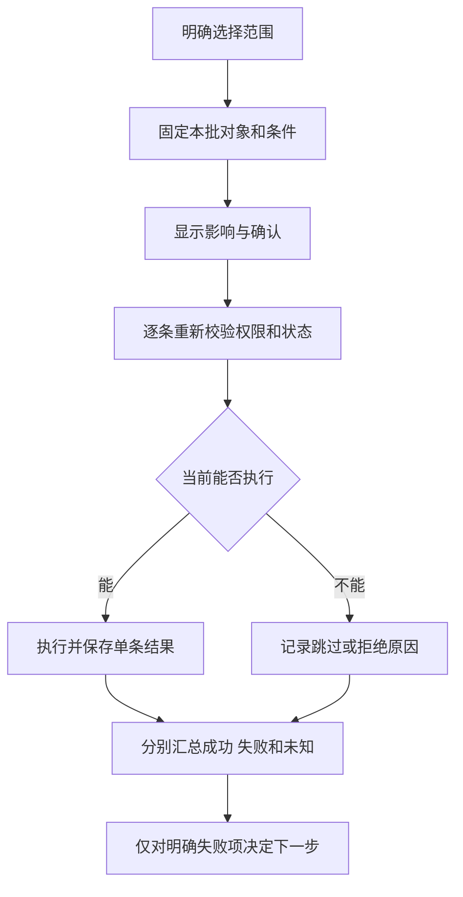

## 一句话解释

批量操作需要先确认对象范围，再逐条判断当前是否允许执行。一个批次被受理，不代表每条记录都成功；结果应区分成功、失败、跳过和仍未确认的对象。

## 适合谁看

适合定义后台行为的产品、交互、设计、开发、运营和测试人员。本页[批量关闭工单演示](#bulk-action-demo)使用八条虚构工单，只改变当前页面的示例状态，不关闭真实工单，也不执行资金或权限操作。

可先看[筛选与列表状态](/articles/admin-filter-list-states#list-demo)，理解输入条件、成功查询的结果和分页，再观察批量动作怎样固定范围。

## 当前页和全部匹配不是一个范围

| 选择方式 | 本例包含什么 | 必须说明 |
|---|---|---|
| 手动选择 | 用户明确勾选的编号 | 已选数量与编号，不能暗中加入未勾选对象 |
| 选择当前页 | 当前页最多三条记录 | 不是全部查询结果 |
| 选择全部匹配 | 当前状态条件匹配的全部记录 | 条件快照、数量、适用时间与排除项 |
| 仅选择失败项 | 上一个批次明确失败的编号 | 不重做已成功项；未知项需先核对原结果 |

本例翻页或改变状态筛选会清除选择，并在分页附近说明规则。真实系统也可以保留跨页选择，但必须明确当前已选对象，避免把“翻页后看不见”理解成“已经取消”。

生产数据会变化。选择全部匹配时，应约定是固定编号集合、基于某个数据版本的查询范围，还是执行时重新求值；这三种行为不能混用。本例创建确认窗口时固定编号集合，不把后来出现的记录加入本批。

## 确认窗口要回答四件事

1. **做什么**：本例动作是关闭工单。
2. **对谁做**：显示范围、筛选与全部选中编号。
3. **有什么影响**：工单状态改变；本例仅允许仍为待处理的记录进入关闭动作。
4. **什么情况下不执行**：已关闭、已失效、权限不足或条件变化时按规则跳过或拒绝，并显示原因。

确认不等于审批。涉及资金、权限或其他敏感变更时，还需按业务要求明确独立审批、授权和审计；可参考[权限与审批](/articles/access-approval-audit#权限检查的四个维度)。

## 执行时重新校验

确认窗口打开后，记录仍可能被其他人员处理。本页提供“模拟一条状态变化”：使一条选中工单提前关闭，再执行本批时，该对象应跳过，而不是再次关闭。

暂停按钮用于减少重复操作，服务端仍需保证同一业务动作的受理边界与单条结果可查询。真实执行超时后，应先查原批次；不能仅凭界面没有收到响应就重新执行全部对象。

## 八条虚构记录怎样得出批次结果

本例全部八条工单中，五条待处理、三条已关闭，每页三条。默认模拟下一次执行中的一条失败，不模拟未知结果。

| 路径 | 本例结果 | 可以观察什么 |
|---|---|---|
| 当前页三条，不模拟失败 | 两条成功、一条跳过 | 当前页不等于全部八条 |
| 全部八条，模拟一条失败 | 四条成功、一条失败、三条跳过 | 批次完成不等于全部成功 |
| 全部八条，再模拟一条状态变化 | 三条成功、一条失败、四条跳过 | 确认后仍要按当前状态校验 |
| 选择上批唯一失败项再执行 | 只处理一条，默认不再注入失败 | 已成功对象不进入重试范围 |

每个批次在演示操作记录中使用独立编号，如 `BULK-DEMO-01`。这些记录只存在于本次页面体验，刷新后重置，不代表服务端持久审计。

## 部分失败后怎么继续

结果说明应保留原批次号、对象编号、单条结果和原因。对于明确失败项，核对原因与当前条件后，再决定是否创建新的处理尝试；已成功项不应被自动加入。

未知项与明确失败项需要分开。本页只演示已确定的失败，因此“仅选择失败项”不包含未知项。真实系统若无法确认是否已经执行，应通过原业务号查询或复核，不把未知状态直接计入失败重试。

跳过也不等于失败。本例已关闭的工单不满足动作前提，跳过是正常的状态判断；它需要结果说明，但不需要重复执行。

## 对照现有后台材料

[后台角色导览](/cases/admin-optimization#admin-role-tour)展示列表和详情的实际演示页面截图，可以观察编号、状态和动作位置。本页批量逻辑是独立的说明示例，不据此声称原后台已经具备这套服务端能力。

[导出任务演示](/articles/export-masking-audit#export-task-demo)提供另一种批量任务：固定筛选快照后生成脱敏文件，下载权限与创建权限分别判断。两类任务都要保存范围，但其影响、结果和重试规则不同。

## 评审与验收对照

- 当前页、全部匹配和失败项选择都有可辨认的范围与数量。
- 取消确认后没有提交批次；状态变化与批次执行分别说明。
- 执行中不能重复提交，完成后保留单条结果及批次编号。
- 失败、跳过与未知分别定义，成功项不被自动重做。
- 手机能阅读对象范围、结果与确认按钮，键盘可取消或确认。

可以使用[项目需求表](/templates/white-label-requirement-form)记录本项目的范围、状态和权限约定，再按[版本验收矩阵](/articles/requirements-release-acceptance#验收矩阵)留下实际验证证据。

## 风险与注意事项

- 本页没有模拟真实服务端鉴权、审批、分布式执行或未知结果查询。
- 删除、冻结、调账等动作不能直接沿用关闭工单的规则，应分别定义影响与恢复边界。
- 筛选内容、对象编号、规则版本与操作原因应按数据敏感度保存和展示。
- 本地按钮限制与演示记录不证明生产系统具备防重复或不可篡改审计。
