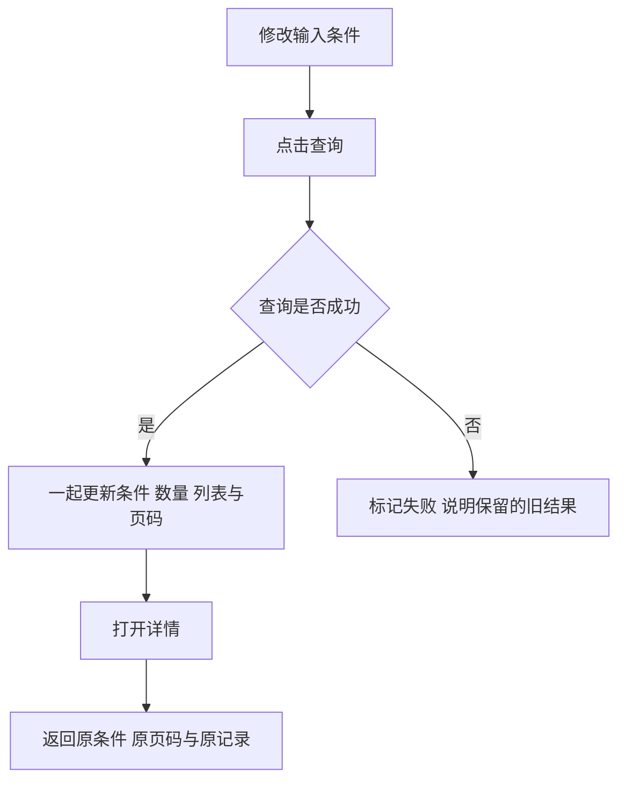

## 一句话解释

改了输入框，不代表列表已经更新。点击查询并成功返回后，才替换结果。

## 适合谁看

产品、交互、设计、开发、运营和测试可先看[四幅界面对照](#visual-guide)，再操作[工单列表](#list-demo)。八条工单均为虚构记录。

## 阅读与演示入口

图1、图2看点击查询前后；图3看无结果与失败；图4看详情返回。实际页面参考[后台案例](/cases/admin-optimization#admin-role-tour)。

## 输入条件与已应用条件

图1下拉框改为“已关闭”，但尚未查询，因此列表仍标“全部，共8条”。图2查询成功后，条件和结果一起变为“已关闭，共3条”。

“已应用条件”指当前列表实际使用的条件。本例点击查询才生效；若做即时搜索，需要另行定义触发时机和过期响应处理。

## 五种列表状态分别表达

- 初次加载：还没有结果，显示正在读取。
- 更新查询：保留旧结果时，明确标记正在更新。
- 有结果：条件、数量、排序和页码对应同一次成功查询。
- 无匹配：成功查到0条，提供修改或清空条件入口。
- 查询失败：没取得新结果，不能把旧数量改成0。

无权限应单独表达，并清除当前账号已无权查看的受保护缓存。本例不模拟权限拒绝。

## 查询与返回流程

后发的查询先返回时，晚到的旧响应不能覆盖它。按钮暂停不能代替响应归属与服务端权限检查。

## 虚构记录的完整走查

默认更新时间倒序，每页三条，时间为UTC+8。

1. 翻到第二页，打开 `DEMO-T005`，返回后仍在第二页。
2. 查询“已关闭”，应得到 `T007、T004、T001` 三条。
3. 查询 `DEMO-NOT-FOUND`，观察无匹配与清空入口。
4. 清空条件，模拟查询失败，再点击重试，比较旧结果和新结果标识。

## 详情返回需要保留什么

保留条件、排序、页码、原记录、阅读位置与焦点。记录已不匹配或页码失效时，说明变化并回到有效位置。

本例在同一页面保存状态，刷新重置。跨页面可参考本站[角色筛选与文章往返](/articles?role=interaction)，将可分享条件放在网址中。

## 评审与验收对照

按四幅图核对条件与结果是否一致、失败与无结果是否区分、返回是否恢复原位置。在1440与390宽度及键盘操作下检查同样路径。

## 风险与注意事项

- 本地演示不证明真实分页接口、持久化或权限隔离能力。
- 手机卡片保留编号、状态、时间和动作；宽表仅局部滚动。
- 不把凭据、完整身份资料与敏感结果保存到网址或浏览器存储。
- [批量操作](/articles/admin-bulk-actions#visual-guide)与[导出任务](/articles/export-masking-audit#export-task-demo)需独立说明范围。
