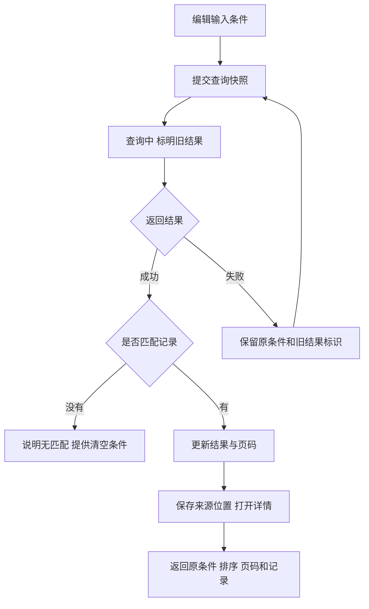

## 一句话解释

后台列表应让用户知道当前结果对应哪些条件、查询有没有完成，以及打开详情后怎样回到原来的记录。正在输入的条件、最后一次成功查询的条件和正在查看的页码要分别表达。

## 适合谁看

交互与设计人员可用它检查查询反馈与恢复路径；产品人员可用它定义筛选、分页和返回规则；开发与测试人员可对照请求顺序、状态保留和异常反馈。这里的八条工单均为虚构示例，不是实际客户记录。

## 阅读与演示入口

先了解[后台信息层级](/articles/admin-information-hierarchy)，再操作本页[筛选与列表演示](#list-demo)。[后台案例的三角色导览](/cases/admin-optimization#admin-role-tour)提供实际演示页面截图，可对照列表与详情的信息位置；[界面状态对照](/design/states)说明其他常见状态。

## 输入条件与已应用条件

本例采用点击“查询”后生效的方式。用户修改输入框时，列表仍属于上一次成功查询，直到新请求成功才替换结果、数量和页码。若采用即时搜索，应说明触发时机，并处理输入间隔和过期响应。

| 信息 | 本例规则 | 界面表达 |
|---|---|---|
| 输入条件 | 用户正在编辑的编号、标题、状态与排序 | 保留在输入框和选择框中 |
| 已应用条件 | 最近一次成功返回结果的条件快照 | 结果上方明确显示 |
| 结果数量 | 与同一次成功查询的条件一致 | 与条件摘要一起更新 |
| 页码 | 新查询成功后回到第一页 | 分页区域展示当前位置 |
| 详情来源 | 打开记录时的条件、排序、页码与位置 | 返回原记录，而非默认第一页 |

不能在输入框变化时就把旧列表标成“新条件的结果”。查询失败后也不能把旧数量改为零，让用户误以为业务中不存在记录。

## 五种列表状态分别表达

| 状态 | 判断依据 | 反馈 | 可执行动作 |
|---|---|---|---|
| 初次加载 | 尚无成功结果 | 说明正在读取；结构占位不伪装成真实记录 | 等待或按规则取消 |
| 更新查询 | 已有结果，新条件正在请求 | 标明保留上次结果，避免用户把它当成新结果 | 本例暂停再次查询与打开详情 |
| 有结果 | 查询成功且记录数大于零 | 条件、数量、排序和页码一致 | 打开详情、翻页或修改条件 |
| 无匹配结果 | 查询成功且当前条件匹配零条 | 显示当前条件并提供修改与清空入口 | 扩大范围，不把无结果写成系统失败 |
| 查询失败 | 未取得本次可信结果 | 说明失败；保留的旧结果标明来源 | 重试当前条件或稍后处理 |

本例不模拟权限拒绝。实际系统应将“无权限”单独表达，不用空列表暗示没有业务记录，也不能继续展示当前账号已无权查看的缓存数据。

## 查询与返回流程

生产实现还要处理请求乱序。例如先发查询 A、后发查询 B，却先收到 B 的响应。界面应只接受与当前查询快照匹配的有效响应，不能让晚到的 A 覆盖 B。暂停按钮可以减少重复请求，但不能代替服务端权限检查和客户端响应归属判断。

## 虚构记录的完整走查

本例固定八条记录，时间显示为 UTC+8，每页三条，默认按更新时间从新到旧。无需对接任何服务即可观察界面行为。

1. 保持全部状态，进入第二页，打开其中一条记录。
2. 点击“返回原列表”，核对仍在第二页，原记录按钮恢复焦点，页面位置保留。
3. 在编号框输入 `DEMO-T008` 后点击查询，应得到一条记录并回到第一页。
4. 输入 `DEMO-NOT-FOUND` 后查询，应显示无匹配记录，并能清空条件恢复八条。
5. 改变状态或关键词后点击“模拟查询失败”，界面保留上次成功结果，并明确说明其不对应新输入。
6. 点击“重试当前条件”，成功后再切换为新结果。

演示的详情在同一页面内切换，只保留本次操作的局部状态。真实列表若跨路由、刷新或分享，应把可分享的筛选放在网址中，并按业务需要保存页码、排序和返回位置。本知识库的[角色图解筛选](/articles?role=interaction)就是网址筛选与文章往返的实际入口。

## 详情返回需要保留什么

最少保留筛选、排序、页码、打开的记录标识、阅读位置和键盘焦点。若详情操作改变了列表，返回后要重新确认记录是否仍匹配条件；记录消失或总页数减少时，说明原因并回到仍有效的位置，而不是恢复一个已经不存在的页码。

手机可把记录改成卡片，但编号、文字状态、更新时间和详情动作仍要可辨认。宽表需要局部滚动时，应提供表格标签；不要把整页缩小来容纳所有列。

## 评审与验收对照

- 修改输入但未查询时，旧结果仍标为旧条件。
- 查询成功时，数量、列表与条件来自同一响应。
- 查询失败、无匹配、无权限分别有明确说明。
- 快速重复查询和响应乱序不会替换成过期结果。
- 详情返回恢复原记录及可用位置；数据变化时有合理回退。
- 1440 与 390 宽度下，筛选项、分页和主要动作可见，键盘可完成操作。

可将以上行为写入[需求与版本验收说明](/articles/requirements-release-acceptance)，再使用[需求说明表](/templates/white-label-requirement-form)记录触发条件与预期结果。

## 风险与注意事项

- 演示的本地状态不代表生产系统具备持久化、分页接口或权限隔离能力。
- 查询失败时是否保留旧数据，需要结合数据敏感性和权限变化决定；权限失效时应及时清除受保护内容。
- 全选、批量操作和导出必须说明作用于当前页还是全部匹配记录；导出规则可参考[导出、脱敏与下载审计](/articles/export-masking-audit)。
- 不在网址或浏览器存储中保存凭据、完整身份信息和敏感查询结果。
