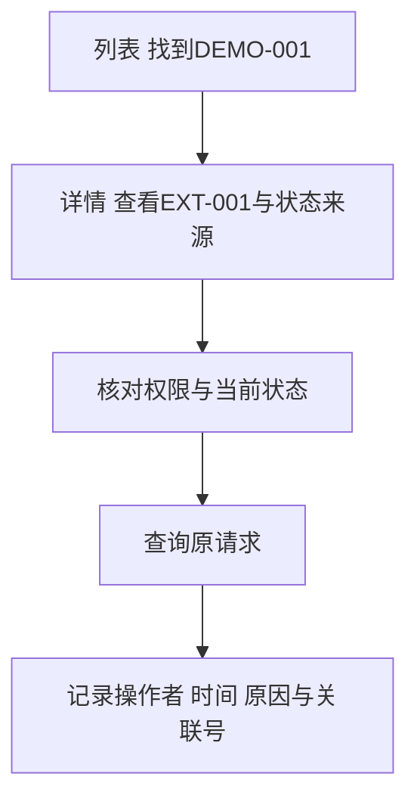

# 复杂后台页面怎样安排信息层级？

先看[界面信息图](#visual-guide)，再用[四层信息演示](#scenario)切换筛选、列表、详情和异常状态。示例订单为虚构数据。

## 先区分默认信息与按需信息

列表先显示完成当前判断所需的编号、状态、金额、时间与详情入口。外部编号、日志和历史备注放到详情中查看。

## 列表页的重点随任务变化

查询订单时突出编号和状态；审核风险时突出触发原因和待办动作。先确定任务，再决定默认列，避免把所有字段放在同一层。

## 状态反馈必须交代四件事

图中“原交易仍在确认”的提示同时交代：是哪笔订单、为什么尚无结果、当前没有确认终态、可以查询原请求。状态文字与动作一起显示，不只改变颜色。

## 危险操作要把影响放在确认前

取消、退款或调整前，写清对象、数量、变化和恢复边界。查看详情的权限不等于执行调整的权限；批量场景见[范围确认图](/articles/admin-bulk-actions#visual-guide)。

## 一句话解释

列表负责找到对象，详情负责解释依据，操作区域说明下一步，记录区域供追溯。

## 同一条记录如何从列表走到审计

图解沿用订单 `DEMO-001`：列表显示100.00 DEMO与“确认中”；详情关联 `EXT-001`；查询动作与操作记录都关联原订单。

查询记录不改变余额，也不证明真实系统已经具备持久审计能力。

## 用现有后台截图逐项对照

本页信息图下方复用[后台案例](/cases/admin-optimization#admin-role-tour)的充值记录截图。截图来自本地演示页面；图中的DEMO订单是独立讲解示例。

观察三个位置：列表上方的筛选、每行记录的识别信息、右侧的详情入口。可放大截图查看字段。

## 手机只保留判断所需的信息

将一条记录排成卡片，保留编号、状态、金额、时间和详情入口。日志按需查看；固定底部操作时给正文留出空间，不缩小整张宽表。

## 风险与注意事项

- 涉及资金与权限的动作，提交前和执行时都要检查授权、范围和当前状态。
- 网络超时先查询原动作，不能推断失败后直接再执行。
- 演示中的记录与图示不代表真实生产数据和服务端能力。

## 用场景走查代替只看设计稿

分别检查正常、无结果、无权限、加载、失败和返回路径。返回列表时恢复条件、页码和原记录位置；数据已变化时解释回退位置。

## 小结

读者应先辨认对象和状态，再找到依据与下一步。完整日志可以晚看，关键影响需要在操作前看清。
