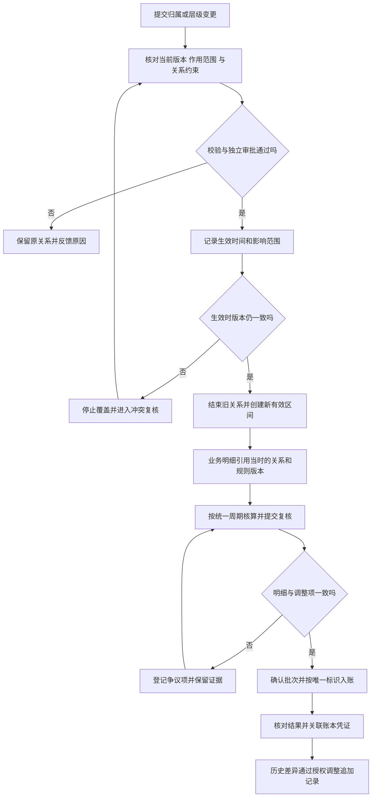

## 一句话解释

代理系统管理渠道合作身份、上下级关系、会员归属与结算记录；设计重点是让每笔业务能够回答“当时属于谁、使用哪版规则、按什么明细核算、谁批准、如何纠正”。推广链接只是关系建立的入口。

本文使用虚构教学模型，不连接真实代理、佣金或付款系统。编号、周期、时间、金额和规则版本均为虚构，不代表实际业务收益或对某种合作方式的推荐；具体规则以项目合同、适用要求和正式配置为准。

## 适合谁看

- 产品：定义代理层级、会员绑定、规则生效和结算状态。
- 运营与客服：解释归属争议、变更申请和报表差异，明确可处理范围。
- 财务、技术与测试：追踪核算明细、规则版本、入账结果、冲正与审批证据。

## 学习路径

1. 从[会员、代理与平台关系](/articles/member-agent-platform)认识角色，再读[会员账号状态](/articles/member-account-states)，区分账号限制和关系归属。
2. 按本文的概念、状态与流程，确定绑定、变更和核算边界。
3. 用虚构明细复核规则生效前后与已结算调整，再用[数据报表指标](/articles/data-report-metrics)统一统计口径。
4. 填写[代理系统 PRD 模板](/templates/agent-system-prd)，涉及入账与差异时对照[钱包支付对账专题](/articles/wallet-payment-reconciliation)。

## 概念与边界

| 概念 | 含义 | 本例约定 |
|---|---|---|
| 代理身份 | 合作角色及其授权范围 | 与普通会员权限分开，同一自然人拥有多个角色也不共享全部数据 |
| 代理层级 | 代理之间的上下级关系 | 每个代理同一时刻只有一个直属上级；校验深度、自指和关系环 |
| 会员归属 | 会员与代理的业务关系 | 每个会员同一时刻至多一个有效归属；无有效来源则保留待核实，不随意填入某代理 |
| 推广链接或邀请码 | 记录来源的入口凭据 | 本例在注册确认时核对来源与有效性，重复提交不重复绑定 |
| 规则版本 | 核算条件和计算口径的快照 | 每版记录适用对象、生效时间、审批和调整原因，历史记录可查 |
| 结算批次 | 在约定周期内核算和审核的记录集合 | 保留明细版本、归属版本、规则版本、调整项及处理结果 |
| 外部付款 | 实际支付执行及结果 | 与核算、审批、钱包入账分别记录，不能只用一个“已结算”覆盖全部过程 |

代理等级、代理层级和佣金方案不是同一个字段。等级变化不应隐式改写上级，暂停合作也不等于取消已经确认的历史结算；需要分别确定生效范围与审批依据。

### 归属和规则需要哪些字段

- 关系记录：会员或代理 ID、原上级、新上级、有效起止时间、关系版本、来源、变更单和审批人。
- 规则记录：版本 ID、适用范围、统计基数定义、计算方法、排除项、周期、时区、币种、精度、舍入规则和生效时间。
- 核算记录：业务明细 ID、业务发生时间、关系版本、规则版本、原始核算金额、调整项、批次与状态。
- 审计记录：申请人、审核人、原因、前后差异、操作时间、处理结果和可受控访问的证据。

本例按“业务发生时刻”选择关系与规则版本，核算时间只是处理时间。若项目改用结算完成时刻等口径，必须明确写入约定，不能在不同报表中混用。

## 状态与处理

### 关系变更

| 状态 | 进入条件 | 代理或用户反馈 | 后台动作与生效条件 |
|---|---|---|---|
| 待核实 | 来源缺失、失效或归属冲突 | 说明资料待核实，提供联系渠道 | 保留来源证据，核实后再确定关系，不凭最近点击覆盖既有绑定 |
| 变更待审核 | 有权限的角色提交归属或上级变更 | 显示申请中，旧关系仍按约定生效 | 核对原因、权限、影响范围、自指与环；申请人不能审批自己的变更 |
| 已批准待生效 | 审批通过且设置生效时间 | 显示计划生效时间和适用范围 | 到期校验当前关系版本，冲突则转复核，不强行覆盖 |
| 已生效 | 生效条件与版本核对通过 | 展示当前有效关系 | 结束旧区间、创建新区间，保留历史快照和操作日志 |
| 已拒绝或撤销 | 审核未通过或允许撤销 | 告知结果和可公开的原因 | 保留旧关系；已生效变更不得用撤销按钮抹去历史 |

### 核算与入账

| 状态 | 处理要求 | 展示与审计 |
|---|---|---|
| 待核算 | 明细齐备后按选定版本计算 | 说明统计周期、时区、资料版本和未齐备项 |
| 待复核 | 明细金额、归属、规则和调整项可追溯 | 审核人查看差异与依据，争议项单独标识 |
| 已确认 | 审批通过并冻结本次核算快照 | 保留审批、批次编号与金额；不代表已到账或已付款 |
| 入账处理中 | 按唯一业务标识请求内部账本记账 | 结果未知先查原请求，不另造一笔入账 |
| 已入账 | 已取得可关联的有效账本凭证 | 可查入账流水；如有外部付款，另查付款状态 |
| 已取消 | 本例中尚未确认且允许取消的批次结束 | 记录取消原因；已确认或已入账差异走调整流程，不删除原记录 |

代理后台只展示授权范围内的会员和核算摘要。财务审批备注、完整联系方式、身份材料或内部风险识别条件不因“直属关系”自动开放。

## 流程图

会员首次绑定也需要核对来源和唯一归属约束，但不应伪造一份“原代理”记录。修改层级或规则时，先完成影响评估，再决定是否允许未来生效。

## 虚构示例

### 一次归属变更如何影响历史明细

本例约定时间为 Asia/Shanghai。会员 U-DEMO-101 原归属代理 A-DEMO-01，变更单 CHG-DEMO-02 在 2026-10-23 09:30 审批通过，约定 10:00 生效至代理 A-DEMO-02。旧有效区间在 10:00 结束，新区间从 10:00（含）开始，不得重叠。

| 业务发生时刻 | 应引用的关系 | 核对结果 |
|---|---|---|
| 09:59 | 原代理与旧关系版本 | 即使 10:30 才核算，也不移给新代理 |
| 10:00 | 新代理与新关系版本 | 与生效边界一致，只归属一次 |
| 10:01 | 新代理与新关系版本 | 可以追溯批准变更单 |

规则变更也要独立审批。例如规则 V2 于 10:00 对指定范围生效，09:59 的业务仍引用 V1；不能仅因为代理当前属于新方案，就重算所有历史明细。

### 一个结算批次怎样保留调整证据

以下只演示账务追溯，不定义真实佣金费率或承诺收益。批次 ST-DEMO-01 的统计区间为 2026-10-23 00:00（含）至 2026-10-24 00:00（不含），币种 CNY、精度两位小数；各行金额是虚构的已核准明细结果，实际核算需按合同与规则执行。

| 记录 | 原金额或调整额 | 关联依据 |
|---|---|---|
| CALC-DEMO-01 | 20.00 | 业务明细与关系快照，规则 V1 |
| CALC-DEMO-02 | 12.00 | 另一组业务明细与关系快照，规则 V2 |
| ADJ-DEMO-01 | -3.00 | 对 CALC-DEMO-01 的独立审批调整，保留原记录 |
| 本批确认金额 | 29.00 | 20.00 + 12.00 - 3.00，能回到三条来源 |

确认批次后，内部入账用固定业务标识 ST-DEMO-01:credit。重复通知或重试不重复生成有效入账。若入账后发现差异，先核对原凭证，再追加获批调整；页面“已确认”不能显示为“已付款”。

## 异常场景

| 情况 | 先核实什么 | 处理与关闭证据 |
|---|---|---|
| 两个来源同时申请绑定 | 当前关系、来源时间、有效性、绑定规则与请求版本 | 只确认一份有效归属；冲突保留证据并复核，不靠最后一次写入决定 |
| 上级变更形成关系环 | 当前与拟变更关系、授权范围、允许层级深度 | 拒绝自指、循环和越权变更；记录校验结果，不发布半生效关系 |
| 批准后关系又发生变更 | 审批引用版本与生效时当前版本 | 暂停执行并重审，不能用旧审批覆盖新事实 |
| 新规则影响已确认批次 | 原规则、适用范围、业务时间、原核算快照 | 历史结果保持可查；确需更正时走授权调整，记录影响与依据 |
| 结算争议或金额不一致 | 明细、关系快照、版本、时区、排除项与舍入规则 | 标明争议范围与责任人，重新核对后审批关闭，不直接改总数 |
| 入账请求超时或通知重复 | 原批次、业务标识与已有有效凭证 | 查询原结果；经确认再补偿，同一业务只入账一次 |
| 代理账号受限或会员恢复 | 账号限制范围、当前与历史关系、未决批次 | 访问或合作权限按约定处理，历史归属和已确认记录不自动清除 |

## 评审检查清单

- [ ] 代理身份、等级、层级、会员归属与规则版本使用独立字段。
- [ ] 有效来源、首次绑定时点、无来源与并发冲突的处理明确。
- [ ] 层级约束、防自指防环、最大深度与操作权限可验收。
- [ ] 变更具有原因、前后差异、版本、审批、生效时间和影响范围。
- [ ] 同一时刻有效归属唯一，历史关系区间和业务快照能追溯。
- [ ] 规则明确统计基数、排除项、周期、时区、币种、精度、舍入与生效口径。
- [ ] 核算、复核、确认、内部入账与外部付款分别展示和记录。
- [ ] 已确认或已入账结果不被静默重算，调整保留原始依据与复核人。
- [ ] 重复请求、结果未知和补偿不会重复入账；差异有明细、负责人和关闭证据。
- [ ] 查询、归属变更、审批、规则发布、入账和导出按职责分离并脱敏。

在[代理系统 PRD 模板](/templates/agent-system-prd)记录范围、角色、测试输入、期望、实际结果与证据；需要对账时复用[钱包支付与对账检查表](/templates/wallet-reconciliation-checklist)。

## 相关资料

- 术语：[代理](/glossary#agent)、[会员归属](/glossary#member-attribution)、[规则版本](/glossary#rule-version)、[对账](/glossary#reconciliation)、[后台权限](/glossary#admin-permission)。
- 概念：[会员、代理、平台关系](/articles/member-agent-platform)、[会员账号状态](/articles/member-account-states)。
- 核算：[数据报表指标](/articles/data-report-metrics)、[钱包支付与对账](/articles/wallet-payment-reconciliation)。
- 模板：[代理系统 PRD](/templates/agent-system-prd)、[数据报表口径](/templates/data-report-spec)、[账号状态评审](/templates/member-account-review)。

## 风险与注意事项

- 本文解释产品与审计边界，不提供真实收益预测；任何核算须依据适用合同、正式规则和可核对明细。
- 多层结构会增加关系、权限和结算复杂度，应先确认实际业务需求，不以层级数量作为完整性标准。
- 会员归属变更不等于账号恢复、资金解冻或补付授权，不同操作分别审批。
- 代理可见范围应受服务端权限控制，按需要脱敏。不得通过导出或历史关系查询绕过现行访问限制。
- 本文和模板仅供学习与评审，不证明系统已经实现并发控制、幂等、审计或实际支付能力。
