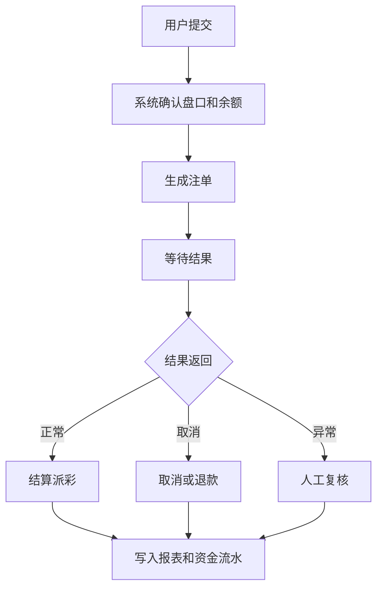

# 注单状态有哪些？

## 一句话解释

注单状态记录的是用户一次投注行为从提交、确认、等待结果到结算或取消的全过程。

## 适合谁看

- 需要设计注单列表和注单详情的产品
- 需要排查用户咨询的客服
- 需要理解结算和派彩流程的开发
- 需要看懂注单报表的运营

## 核心结论

- 注单不是一条静态记录，而是一条有生命周期的业务记录。
- 常见状态包括创建中、已确认、待结算、已结算、已取消、异常。
- 注单状态必须能关联金额、赔率、结果、钱包流水和操作日志。
- 异常注单要保留原因和处理记录。

## 状态流程

## 常见状态说明

| 状态 | 含义 | 排查重点 |
|---|---|---|
| 创建中 | 用户已提交但系统仍在确认 | 盘口、赔率、余额 |
| 已确认 | 注单已生成并锁定 | 金额、赔率、时间 |
| 待结算 | 等待赛事或游戏结果 | 结果来源、状态同步 |
| 已结算 | 已完成输赢和派彩 | 钱包流水、报表 |
| 已取消 | 注单被取消或作废 | 原因、退款记录 |
| 异常 | 状态不完整或结果冲突 | 日志、复核、补偿 |

## 业务状态与资金动作不要合并

厂商状态码需要映射到平台业务状态，并保留原始值和映射版本。“结果未知”表示证据不足，不是失败；“异常”是待排查分类，不应成为无期限的终态。下面是说明用模型，实际以玩法和厂商契约为准。

| 状态变化 | 需要的证据 | 资金影响 | 页面下一步 |
|---|---|---|---|
| 提交 → 受理 | 厂商受理号、锁定条件 | 按约定完成扣款或冻结 | 查看原注单，禁止盲目重复提交 |
| 提交 → 拒绝 | 明确拒绝码、未受理确认 | 未记账则不退款；已冻结则关联解冻 | 展示原因与可修改项 |
| 受理 → 已取消 | 原注单、取消原因与版本 | 按原资金动作退款或解冻一次 | 查看关联补偿流水 |
| 受理 → 已结算 | 结果、结算版本、金额口径 | 记录派彩或结算流水 | 展示结果与资金明细 |
| 已结算 → 重新结算 | 更正依据、新旧版本 | 对差额调整或按协议冲正重记 | 同时显示原结果和更正记录 |
| 任意请求 → 结果未知 | 超时、缺失或冲突证据 | 不自动再次扣款或退款 | 按原号查询、复核与对账 |

## 虚构示例：派彩更正不能覆盖历史

演示注单 `BET-DEMO-001` 已扣本金 100，版本 v1 的“含本金总返还”为 180，钱包已入账 180。厂商更正为 v2 总返还 150，在采用差额调整的契约下，应记录 −30 的关联调整。该注单最终钱包净变化为 −100 + 180 − 30 = +50。

“总返还”在这里包含本金，不能把 180 再加本金 100；若厂商字段只表示净赢额，必须换成对应定义。v2 重复到达不能再次扣 30，v1 晚到不能把状态覆盖回旧版本。调整失败或余额不足时保留待处理原因，不能伪造完成状态。

## 详情页最少保留这些内容

- 业务：平台注单号、厂商注单号、会员与币种、玩法快照、投注金额。
- 状态：原始状态、平台映射、结果版本、发生时间与接收时间。
- 资金：原扣款、派彩、退款或调整的流水号与金额方向。
- 追溯：通知摘要、处理结果、复核人、原因和审批记录。

列表负责快速判断“哪条需要处理”，详情负责解释“为什么是这个结果”。不把接口重试次数当作注单数，也不通过改注单金额来修补钱包差异。

可在本页[注单界面演示](/articles/bet-ticket-status#scenario)观察状态说明，并在[钱包对账案例](/articles/wallet-payment-reconciliation#reconciliation-case)核对资金记录；它们均是演示场景。

## 风险与注意事项

- 注单状态要避免重复结算
- 取消和退款要能关联钱包流水
- 厂商返回结果要做幂等处理
- 后台人工处理要有审批和日志
- 报表口径要区分投注、有效投注、输赢和派彩

## 常见问题

### 客服排查注单要看什么？

看注单号、用户、金额、赔率、状态、结果、结算时间、钱包流水和异常日志。

### 注单异常通常来自哪里？

常见来自接口延迟、结果更正、重复回调、余额同步失败或后台人工处理不完整。

## 相关术语

- 注单
- 派彩
- 补单
- 对账
- 风控规则
