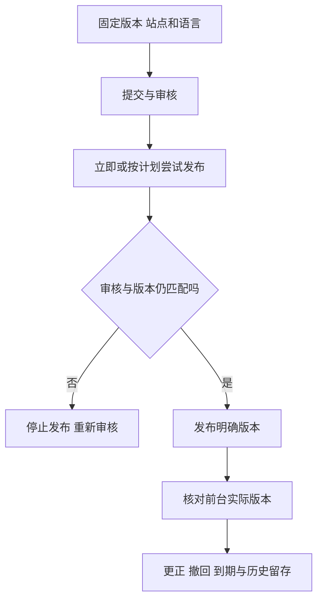

## 一句话解释

保存、送审、审核通过、后台生效、前台可见分别是不同状态。先看[五幅界面图](#visual-guide)，再操作[公告审核与发布演示](#publication-demo)。

## 适合谁看

维护公告与帮助内容的运营、客服，以及定义范围、版本、界面和异常路径的产品、设计、开发与测试人员。

## 内容对象需要哪些范围

每次明确：内容编号、稿件版本、站点、语言、关联规则和有效期。本例只演示站点A/B与中文/English，规则为R7，不涉及真实租户隔离。

前台可单独选择站点和语言，便于核对范围。中文v4发布后，英文仍是原来的v3；站点B没有发布时不显示内容。

阅读记录关联当时看到的具体版本。记录了一次展示，不证明理解、同意或真实送达；实际确认要求需另行定义。

## 正常发布流程

草稿 → 提交审核 → 示例审核员批准 → 立即发布或安排T+10分钟 → 核对后台生效 → 刷新并核对目标前台。

本例时间由“推进10分钟”手动改变，没有真实后台调度。每次生效后有效30分钟，真实项目还应明确日期、时区、有效期和执行时校验。

## 虚构示例：帮助内容定时生效

内容 `CNT-DEMO-001` 初始为站点A的中文v3、英文v3。编辑中文v4并送审，批准后安排10分钟生效。

- 正常：推进时间，后台为v4；前台快照仍为v3，刷新核对后才显示v4。
- 失败：勾选模拟发布失败，再推进时间；保留v3，不把计划时间当作发布成功。
- 改稿：安排后修改为v5，原批准与待执行任务失效；推进时间也不发布新稿。
- 更正：已生效后建立v5，填写更正原因并重新审核。新版本生效前，原v4继续有效。

## 异常处理

审核驳回后可修改再送审；更换站点、语言和已审核正文需要重新核对。缺少目标语言确认时，本例阻止送审，不能把已有中文当作英文已经发布。

发布失败不会自动更新前台。真实执行超时且结果未知时，应先核对原发布任务，不能直接套用本例的明确失败重试。

撤回或推进至到期后，前台停止展示，不自动回退到历史版本；历史版本和阅读事件保留。示例记录可展开查看，刷新页面重置。

## 风险与注意事项

本例为浏览器内的状态模型，不证明真实独立审批、任务调度、缓存失效、访问授权、翻译质量或持久审计。本页的前台快照用于解释旧版本；真实撤回需落实访问校验与缓存失效。

公告申请的字段校验与“已受理”见[表单反馈图解](/articles/form-validation-submit-feedback#visual-guide)，它不等于审核通过或内容发布。

## 关联现有资料

[多租户与站点配置](/articles/multi-tenant-site-config#一次配置变更的路径)解释范围与配置版本；[官网案例](/cases/white-label-official#case-reading-guide)提供内容与反馈材料；[版本验收](/articles/requirements-release-acceptance#验收矩阵)说明核对证据。
