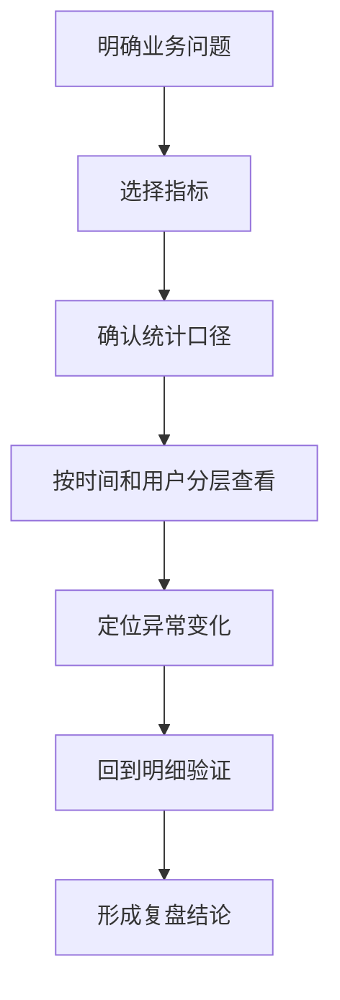

# 数据报表指标怎么看？

## 一句话解释

报表把符合条件的明细合在一起。先看上方四组界面：同一币种、同一天，三笔成功充值100、200、50 USD合计350 USD；其中两笔属于同一会员，所以是2人、3笔。

## 适合谁看

- 需要看运营日报的新同事
- 需要设计报表字段的产品
- 需要统一指标口径的管理者
- 需要复盘活动效果的运营

## 核心结论

- 报表最重要的是指标口径一致。
- 注册、首存、复存、流水、注单和派彩分别回答不同问题。
- 单个数字没有意义，必须结合时间、渠道、用户分层和活动背景。
- 报表要能追溯到明细，否则无法排查差异。
- 导出权限和敏感数据展示要受控。

## 报表分析流程

## 常见指标

| 指标 | 说明 | 常见用途 |
|---|---|---|
| 注册人数 | 创建账号的用户数 | 看获客规模 |
| 首存人数 | 第一次充值用户数 | 看转化质量 |
| 复存人数 | 再次充值用户数 | 看留存和信任 |
| 流水 | 投注金额总量 | 看活跃和活动效果 |
| 注单数 | 生成注单数量 | 看使用频率 |
| 派彩 | 结算后发放金额 | 看资金结果 |
| 留存 | 用户持续回来情况 | 看长期价值 |

## 一个指标需要一张口径卡

| 项目 | 要记录的内容 | 为什么影响结果 |
|---|---|---|
| 名称与版本 | 指标名、定义、负责人、生效时间 | 同名指标可能换过口径 |
| 时间 | 事件时间、入账时间、业务时区、半开区间 | 跨日和延迟会改变归属 |
| 去重 | 会员号、订单号或业务事务号 | 人数、笔数、通知次数不同 |
| 范围 | 站点、币种、渠道、账号排除条件 | 不同筛选不能直接比较 |
| 状态 | 成功、取消、冲正、结果未知的纳入规则 | 创建订单不等于成功入账 |
| 金额 | 最小单位、含本金与否、退款和手续费 | 金额相同也可能含义不同 |
| 追溯 | 明细查询、更新时间、修订记录 | 汇总必须可回到原始业务 |

“复存人数”不等于“复存笔数”；“投注流水”不等于“有效投注”；“派彩”是否含本金必须写清。“留存”也需要固定用户群、起始行为、回访行为和观察日，不能只用活跃用户总数代替。

## 虚构示例：人数、笔数和金额分别核对

上方示例固定站点A、10月28日、UTC+8、USD和成功入账状态。会员A的 `DEMO-R001`、`DEMO-R002` 分别为100、200 USD，会员B的 `DEMO-R003` 为50 USD。成功充值人数为2、笔数为3、金额为350 USD，未含手续费、退款及冲正。记录均为虚构。

R003的重复通知仍指向同一订单，不加一笔。会员B的 `DEMO-R004` 为80 USD，结果未知，没有成功入账时间，暂不加入成功金额。

`DEMO-R005` 为当日100 EUR，切换EUR筛选后单独展示；`DEMO-R006` 为27日23:58入账的40 USD，切换到27日才纳入。R001在UTC时间27日16:03入账，换算为UTC+8的28日00:03，属于28日。不能直接相加不同币种，也不能用服务器日期替代业务时区。

后续若发生冲正，原业务与冲正均应可查，按既定的原日重述或当期调整规则处理，并标明更新时间。

## 从汇总到明细的核对路径

1. 固定指标版本、时区、站点、币种、起止时间和状态。
2. 从汇总进入明细时携带相同筛选，不重新套用页面默认时间。
3. 核对去重键、原业务号、状态、金额方向及事件和入账时间。
4. 对照钱包流水与通道记录；延迟记录进入差异清单，不直接改汇总值。
5. 修订完成后记录口径版本、数据截止时间和调整范围。

## 差异出现时先排除这些原因

- 业务日是 `[开始, 次日开始)`，结束边界不应在两天同时计入。
- 多币种分组展示；汇率折算指标另列汇率来源、日期和舍入规则。
- 同一会员跨站点是否去重，取决于身份命名空间，而不是显示昵称。
- 导出与页面使用相同筛选和权限；“导出全部”要说明范围。

可在[对账案例](/articles/wallet-payment-reconciliation#reconciliation-case)沿同一演示订单查看三份记录，也可对照[代理结算](/articles/agent-system-design#agent-settlement-case)区分原批次与调整明细。

## 风险与注意事项

- 每个指标要有口径说明
- 报表导出要控制权限
- 财务类指标要能追溯明细
- 时间范围和时区要统一
- 活动数据要区分新增、老客和召回
- 异常波动要能定位到渠道或配置变化

## 常见问题

### 新手看报表先看什么？

先看注册、首存、复存、活跃、流水和留存，再逐步看渠道、活动和用户分层。

### 为什么同一个指标不同页面不一致？

通常是统计口径、时间范围、数据延迟或筛选条件不同，需要先统一定义。

## 相关术语

- 数据报表
- 流水
- 首存
- 复存
- 对账
