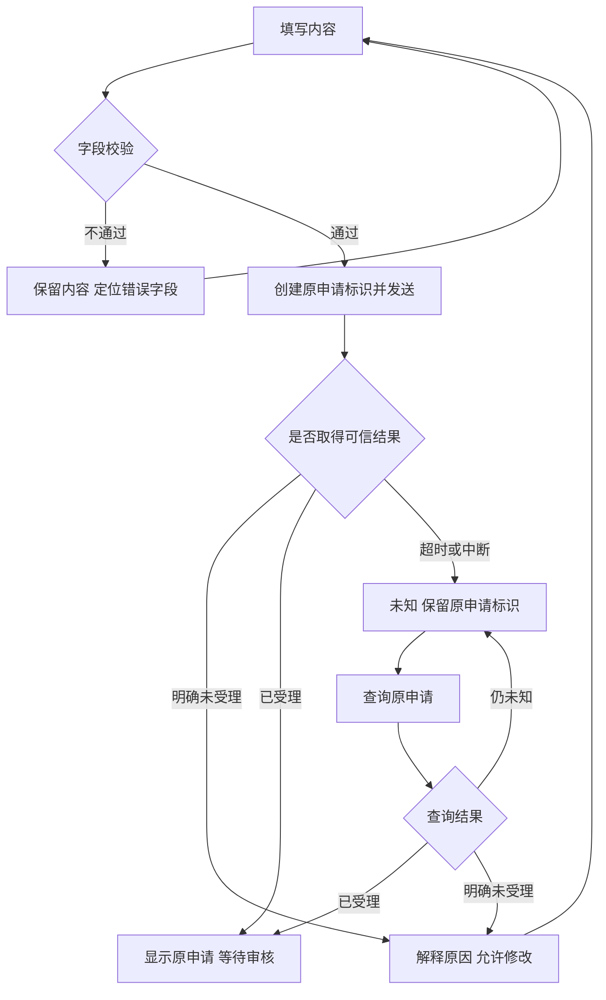

## 一句话解释

表单需要分别说明哪里填错了、是否已经发出请求、服务端有没有受理，以及用户下一步可以修改、等待还是查询原结果。网络超时不能自动等同于业务失败。

## 适合谁看

适合定义表单行为的交互、设计与产品人员，以及实现和检查异常路径的开发、测试人员。本页[可操作的公告申请演示](#form-demo)使用虚构编号和内容，只说明界面反馈，不会向真实后台发送申请。

可先看[后台信息层级](/articles/admin-information-hierarchy)和[界面状态对照](/design/states)，再结合[公告内容与发布版本](/articles/content-publication-versions)理解“申请已受理”与“内容已发布”的区别。

## 前端校验与业务校验

本例要求标题为 4–40 个字符、摘要为 10–120 个字符。这是演示约定，不是行业统一标准。前端先检查格式，可以减少明显错误；服务端仍要检查权限、内容范围、业务状态和数据版本。

| 层次 | 检查什么 | 失败后怎么表达 |
|---|---|---|
| 字段格式 | 必填、长度、格式、可接受范围 | 字段旁说明错误和修改方式，保留其他输入 |
| 跨字段规则 | 起止时间、条件与范围是否冲突 | 在相关字段与摘要中表达关联原因 |
| 权限与业务 | 当前账号能否执行，业务对象是否仍可修改 | 说明未受理原因和允许动作，不伪装成格式错误 |
| 请求结果 | 原请求是否受理、仍处理中或尚无法确认 | 保留业务号，区分明确失败与未知 |

错误不能只靠红色边框表达。字段需要稳定标签、文字说明和可访问的关联；提交时将焦点放到首个错误字段，用户修改后再次提交仍需重新校验。

## 状态与可执行动作

| 状态 | 用户看到什么 | 输入与主按钮 | 下一步 |
|---|---|---|---|
| 填写中 | 规则、示例与填写内容 | 可编辑、可提交 | 校验后发送 |
| 字段错误 | 具体字段问题，说明尚未发送申请 | 保留输入，可修改 | 修改后再次提交 |
| 提交中 | 本次请求正在等待响应 | 暂停重复提交和重置 | 等待响应，不先显示成功 |
| 明确未受理 | 有可信结果表明本次没有被受理 | 本例恢复编辑 | 按原因修改后提交，重新核对业务状态 |
| 结果未知 | 响应超时，尚不能确认是否受理 | 保留原内容与申请号，暂停再次提交 | 查询原申请或交由复核 |
| 已受理 | 原申请已建立，仍等待审核 | 本例锁定内容与再次提交 | 查看原申请的后续状态 |

“已受理”不是“审核通过”，也不是“公告已发布”。按钮完成后的文字应与真实业务阶段一致，不能用统一的“操作成功”掩盖后续步骤。

## 从校验到结果查询

本页演示把“查询原申请”的返回固定为已受理，便于观察不再次提交的路径。真实系统的查询可能继续未知，或者明确未受理；这些情况应按契约分别反馈。一次查询未找到记录，也不必然证明原请求未执行，仍需核对索引延迟、查询范围与服务方约定。

## 虚构申请演算

本例原申请号固定为 `DEMO-ANN-001`。提交次数仅记录有效校验后发送的演示动作，查询原申请不增加次数；重置会清除本次体验数据，不能作为生产业务的“重新提交”方案。

1. 保持空白直接提交，两个字段出现文字错误，焦点进入标题框；提交次数不会增加。
2. 输入标题“帮助中心内容更新”，摘要“调整帮助中心的订单说明与常见问题分类。”。
3. 默认选择“响应超时，结果未知”，提交后先显示提交中，然后显示未知状态与原申请号。
4. 此时输入和提交暂停，内容保留。点击“查询原申请结果”，本例显示已受理、等待审核；申请号不变，提交次数仍为一。
5. 重置演示后选择“明确未受理”，填写后提交。本例保留原内容并恢复编辑，再根据说明修改摘要。
6. 选择“明确已受理”可以观察直接受理路径，但这仍不表示公告已经发布。

## 重复提交要在不同层次处理

前端暂停按钮可以减少连续点击；组件也应防止一次渲染前的快速重复触发。生产系统还需要业务唯一键、原子受理与结果查询能力。按钮变灰不能证明服务端不会重复执行。

多个标签页、刷新重试、网络层重发或不同客户端都可能绕过界面限制。应将业务动作与请求尝试分别记录，并结合[接口幂等、乱序与补偿](/articles/api-idempotency-compensation)确定同一业务的受理边界。

## 错误位置与键盘操作

字段标签始终可见，帮助说明与错误通过关联属性连接。提交错误时保留全部已填内容，并把焦点移到首个错误字段；不要为了显示错误让整页跳到没有说明的位置。

处理中和结果反馈通过状态区域告知读屏用户。手机按钮允许换行，重要结果不依赖悬浮提示；固定动作区不能遮住字段、原申请号或错误说明。对不可编辑的状态，应在状态区域说明原因。

## 评审与验收对照

- 空白和边界长度都有明确反馈；合法提交前不产生申请。
- 格式正确后仍执行服务端权限与业务检查，错误文案不泄露敏感规则。
- 提交期间连续点击只发送本次动作，返回结果前不预先宣告成功。
- 明确未受理时保留输入，允许按原因修改；未知时保留原业务号并查询。
- 查询不新建业务动作；仍未知时保留等待或人工复核路径。
- 已受理、审核通过与已发布分别表达；实际证据可写入[需求说明表](/templates/white-label-requirement-form)。

## 风险与注意事项

- 演示规则、等待时间和固定申请号仅用于说明，不表示真实系统的响应时限或唯一键方案。
- 涉及资金、权限或不可撤销内容时，提交前还需确认对象、范围、影响和授权；参考[权限、审批与审计](/articles/access-approval-audit)。
- 页面离开、刷新或网络恢复后，应按业务契约找回原申请，不能仅凭前端状态推断成功或失败。
- 草稿保存位置、保存期限和清除机制需要独立设计，不将身份资料、凭据或敏感内容默认写入浏览器存储。
