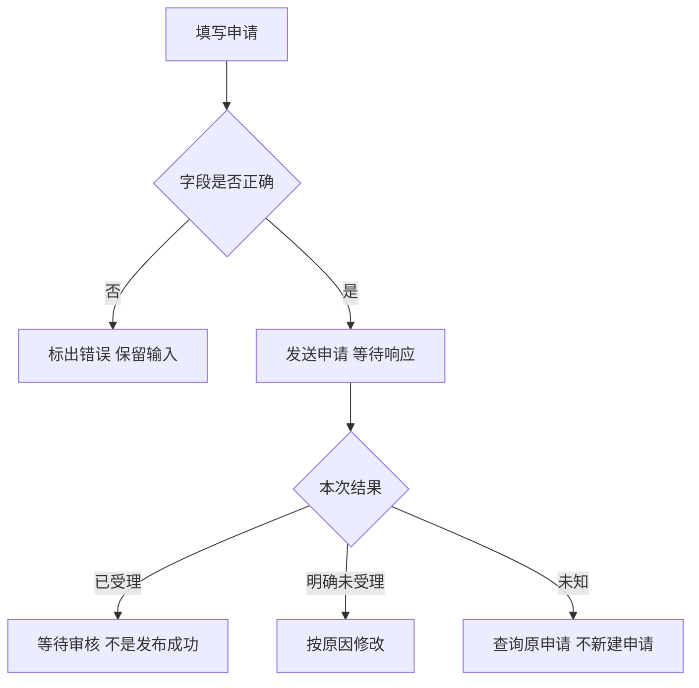

## 一句话解释

填错要指出位置，提交中要等待，结果未知要查原申请。已受理不等于已发布。

## 适合谁看

产品、交互、设计、开发与测试可先看[六种表单界面](#visual-guide)，再操作[公告申请演示](#form-demo)。图中按钮展示各状态下的允许动作。

## 前端校验与业务校验

本例标题要求4–40字、摘要10–120字，仅是演示规则。前端检查格式；服务端仍需检查权限、业务范围、跨字段关系、当前状态和版本。

字段错误放在输入框旁，说明怎么改，并保留其他输入。业务拒绝不能伪装成格式错误。

## 状态与可执行动作

六幅图是状态对照，不是每次申请必经的六个步骤。

- 填错：尚未发送，修改后提交。
- 提交中：等待响应，暂停重复提交和重置。
- 明确未受理：本例恢复编辑，按原因补充。
- 结果未知：保留原号与内容，暂停重发，查询原申请。
- 查询中：等待原结果，不增加提交次数。
- 已受理：查看后续状态，不能据此显示公告已发布。

审核和发布见[公告内容与发布版本](/articles/content-publication-versions)。

## 从校验到结果查询

## 虚构申请演算

1. 空白提交：显示字段错误，不产生提交次数。
2. 填写“帮助中心内容更新”和“调整订单说明与常见问题分类。”，选响应超时后提交。
3. 界面保留 `DEMO-ANN-001`，此时提交次数为1。
4. 查询原申请，本例返回已受理，提交次数仍为1，公告尚未发布。
5. 重置后选择“明确未受理”，观察可修改并重新提交的区别。

本例查询固定返回已受理；真实系统还可能处理中或继续未知，需要等待或人工复核入口。

## 重复提交要在不同层次处理

按钮暂停减少重复点击；服务端仍需定义业务唯一标识、并发受理和原结果查询。查询原申请不能新建一次业务动作。

## 错误位置与键盘操作

字段有稳定标签、文字错误和关联说明。提交时焦点移至首个错误字段，修改后再次校验。状态不能仅用颜色表示。

## 评审与验收对照

按图检查内容保留、错误定位、提交中限制、未知结果原号查询、受理与发布区分。用手机和键盘操作相同路径。

## 风险与注意事项

- 重置仅用于重新体验演示，不是业务重试；固定编号也不是生产唯一键方案。
- 演示不向真实后台发送申请，不证明服务端防重复能力。
- 离开、刷新或断网恢复后，按业务约定找回原申请，不能凭前端画面推断结果。
- 草稿的保存范围、期限与清除机制需另行设计，不默认保存凭据和敏感内容。
