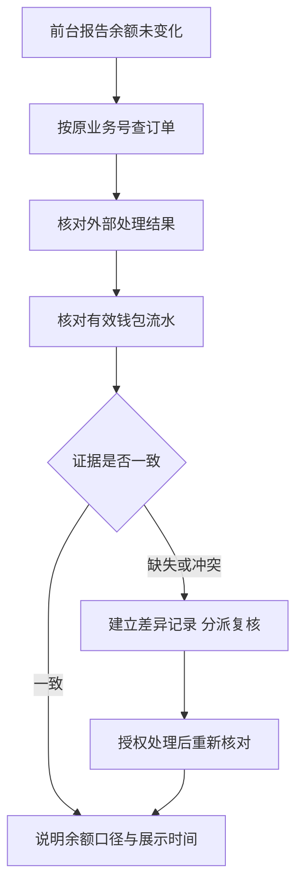

## 一句话解释

平台通过账号、业务订单、钱包记录、外部服务与后台工具协同承接用户操作。理解它的运转，需要同时看“用户做了什么”“哪个系统受理”“什么记录能证明结果”，而不只看页面上的成功或失败提示。

## 适合谁看

适合刚接触平台业务的产品、运营、开发、客服与项目人员。先看[包网组成与职责边界](/articles/what-is-white-label#示例分工与责任边界)，再用本页把不同模块串起来。页面上的原有生态图是概念示意，实际操作与记录以正文和所链接的演示为准。

## 前台动作对应哪些后台记录

| 前台动作 | 需要协作的系统 | 应能追溯的记录 | 不能直接推定什么 |
|---|---|---|---|
| 注册或登录 | 账号、验证、会话与权限 | 账号编号、认证结果、会话或受限原因 | 登录成功不代表可执行所有业务 |
| 充值 | 平台订单、支付服务、钱包 | 原订单、外部编号、回执、有效入账流水 | 支付成功不等于已入账 |
| 进入游戏 | 游戏目录、可用条件、会话与钱包接入 | 游戏标识、会话、接口结果和失败原因 | 入口可见不等于当前可用 |
| 查询注单 | 交易记录、结果来源、账本 | 原交易号、关联结果、更正与资金记录 | 结算状态不单独证明资金已到账 |
| 申请提现 | 审核、冻结、付款服务、钱包 | 申请、审批、付款请求、查询与冻结结转记录 | 请求超时不等于明确失败 |
| 查看活动权益 | 规则、资格、审核与发放 | 规则版本、资格快照、发放状态和流水 | 符合资格不等于已经发放 |
| 联系客服 | 业务查询、权限、通知与工单 | 原业务号、证据、处理人和复核结论 | 工单关闭不自动改变原业务结果 |

这些记录可以由不同系统保存，是否能在一个后台集中查询取决于实际实现。演示材料只展示说明范围，不代表某个真实平台具备全部能力。

## 同一件事可以有几种状态

一笔充值可以同时存在：支付服务已确认、平台订单已收到结果、钱包尚待核对、客服工单处理中。它们描述不同对象，不必用一个“成功”标签覆盖。

虚构记录 `FLOW-DEMO-001` 中，客服先找到原订单，再核对支付记录和有效流水。若支付有确认记录，但钱包没有关联入账，应进入差异复核；不能因为列表写“支付成功”就关闭问题，也不能直接手工补款。

实际可操作的虚构示例见[充值与对账](/articles/wallet-payment-reconciliation#reconciliation-case)。这里的判断顺序是说明模型，不替代具体服务的查询与补偿约定。

## 哪些编号把链路连起来

| 标识 | 用来回答什么 | 关联要求 |
|---|---|---|
| 账号或会员编号 | 当前处理的是谁 | 页面显示脱敏，服务端按权限查询 |
| 原业务号 | 哪一次业务动作 | 重试与查询仍能找到原动作 |
| 外部服务编号 | 对方记录是什么 | 保存与平台业务号的明确映射 |
| 请求或追踪号 | 哪一次通信尝试 | 多次尝试不能被当成多笔业务 |
| 流水号 | 哪一次有效记账 | 关联原动作、币种、方向与更正 |
| 规则或配置版本 | 依据哪套规则处理 | 保存当时生效的范围与时间 |

不用一个编号代替全部层次。尤其在重复通知或网络超时后，应区分业务动作、通信尝试和实际入账，避免重复处理。

## 角色怎样接力处理问题

- **客服**：确认用户问题、原业务号与可公开反馈，保留查询证据。
- **运营或业务人员**：核对规则、范围、资格、活动与内容配置。
- **财务或授权复核人员**：按权限比较订单、账本和外部记录，判断差异是否关闭。
- **技术与运维**：定位接口、日志、版本和运行异常，提供恢复与核对依据。
- **外部服务方**：按服务约定提供原交易查询、结果解释和异常协作。

分工可以因项目而变化，关键是每次交接都说明记录、证据、允许动作和负责人。界面中的角色视角不等于真正的服务端鉴权。

## 从一个问题找到对应页面

| 当前问题 | 看哪份记录 | 站内示例 |
|---|---|---|
| 充值确认但余额未变化 | 订单、通道、有效流水与差异 | [钱包对账演示](/articles/wallet-payment-reconciliation#reconciliation-case) |
| 提现请求超时 | 原申请、原付款请求与冻结记录 | [提现异常演示](/articles/wallet-payment-reconciliation#withdrawal-case) |
| 账号已恢复但仍不能操作 | 账号、会话、验证与单独业务限制 | [账号恢复演示](/articles/member-account-states#account-recovery-case) |
| 代理关系变化后历史结算不同 | 归属区间、规则与批次版本 | [代理跨期结算](/articles/agent-system-design#agent-settlement-case) |
| 列表条件与眼前结果不一致 | 输入条件与最近成功查询快照 | [后台列表演示](/articles/admin-filter-list-states#list-demo) |

## 真实页面材料能说明到哪一步

[后台三角色导览](/cases/admin-optimization#admin-role-tour)提供角色、列表和详情的实际演示页面截图；可观察入口和字段，不据此推定真实支付或账务能力已完成。[官网响应式对照](/cases/white-label-official#official-responsive-comparison)说明服务如何呈现，与内部执行链路属于不同层次。

若要记录本项目的真实分工，可使用[项目需求表](/templates/white-label-requirement-form)；指标的时间、范围和金额定义另见[报表口径](/articles/data-report-metrics#一个指标需要一张口径卡)。

## 风险与注意事项

- 页面、订单、外部服务、账本和工单的状态分别说明，不用一个标签推断整条链路。
- 结果未知时查询原动作；没有结果或证据冲突时分派复核，不自行推定终态。
- 处理和恢复必须在授权范围内，业务原记录与审计证据按约定保留。
- 监控恢复不直接证明业务差异已经核对；可继续看[故障恢复说明](/articles/monitoring-incident-recovery)。
