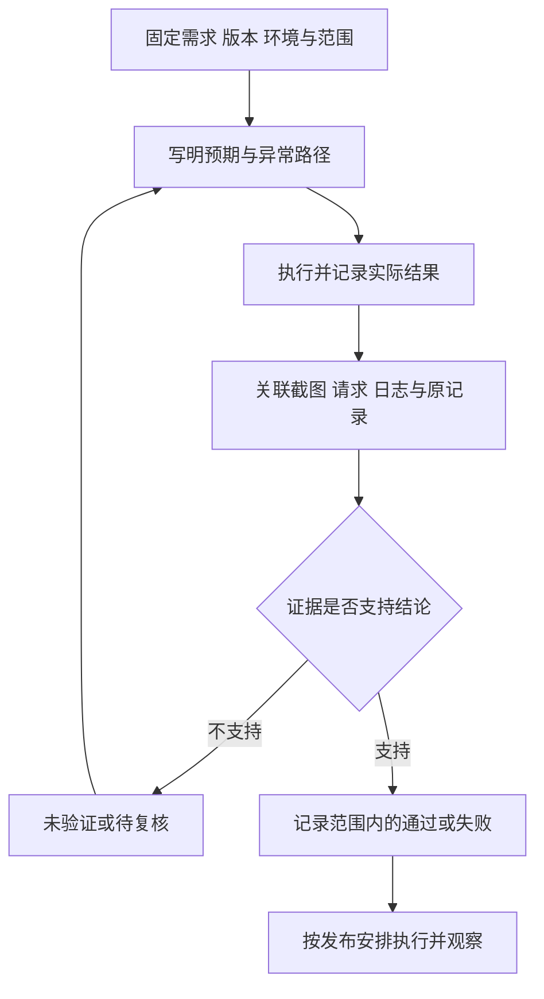

# 博彩平台上线前检查清单

先看[证据图解](#visual-guide)，再切换[验收证据对照](#acceptance-evidence)。总览图保留作补充；实际结论需要版本、环境和执行记录支持。

## 一句话解释

上线验收需要回答：验了哪份版本、在什么环境与范围、预期是什么、实际发生什么、证据在哪里、哪些仍未验证。

## 适合谁看

负责范围确认的产品与项目经理、执行检查的开发和测试，以及安排监控、发布与异常处理的运维、运营人员。

## 核心结论

- 页面能打开、按钮可见、演示可操作，只支持各自范围的观察。
- 预期与实际分别记录；没有执行证据时写未验证，不补成通过。
- 每条记录关联需求编号、版本、环境、角色与站点、时间、结果和证据。
- 失败、未执行、结果未知和待复核分别保留，说明影响与下一步。

## 通俗理解

“导出记录”按钮截图能证明入口可见，不能证明权限、下载范围或拒绝后没有生成文件。需要分别保存真实操作与结果。

## 检查范围

固定本次变更及依赖，区分测试、预发和生产环境。列明站点、语言、币种、时区、授权角色、设备与配置版本；一套环境通过不能替其他范围签字。

## 上线流程

回滚要核对数据和不可逆动作。代码回退不自动撤销已发送通知、外部订单或账务记录。

## 核心检查项

- 账号：登录、会话与受限恢复，参考[账号演示](/articles/member-account-states#account-recovery-case)。
- 资金：关联订单、通道和账本，记录超时、重复与差异，参考[对账示例](/articles/wallet-payment-reconciliation#reconciliation-case)。
- 列表：旧条件、失败、空结果、分页和返回，参考[列表演示](/articles/admin-filter-list-states#list-demo)。
- 导出：创建和下载权限、站点、过期与拒绝，参考[导出任务](/articles/export-masking-audit#export-task-demo)。
- 内容：审核版本、语言、前台生效与撤回，参考[发布演示](/articles/content-publication-versions#publication-demo)。
- 手机：除390px浏览器，还需真机输入法、安全区与文字放大验证，参考[手机布局](/articles/mobile-page-layout#visual-guide)。
- 运维：告警、负责人、止损和恢复证据，参考[故障恢复](/articles/monitoring-incident-recovery)。

## 验收证据记录

[对照里的v26记录](#acceptance-evidence)来自GitHub原生工作流状态，绑定提交 [aa1370b](https://github.com/micjordan9527/game/commit/aa1370b68a3944fcadd5cbc138746a5c3a667890)。两条历史工作流结论为success，对应仓库根路径和/game配置。

它们是本知识库的历史构建与浏览器检查，不能证明新版本或真实生产业务。根路径工作流中的Netlify发布只由手动触发，push检查成功不代表已发布Netlify。

## 常见误区

### 误区一：测试环境通过就可以直接上线

环境、回调、配置、权限与外部服务可能不同，记录实际范围，未覆盖的范围单独列明。

### 误区二：只测正常流程就够了

同时检查无结果、失败、受限、超时、重复操作、取消与返回。结果未知时先查原业务，不能直接重做。

### 误区三：上线后再补监控

发布前确认信号、阈值、负责人和处理路径，并验证触发与恢复。监控存在不等于告警已验证可达。

## 风险与注意事项

公开证据不得暴露生产密钥或完整身份资料；明确账号与站点范围，按项目约定保存和授权。

讲解、截图和演示不能替代真实平台的服务端测试、供应商联调、资金核对或生产批准。历史成功不能自动沿用于新版本。

## 常见问题

### 上线前最应该优先测什么？

按本次变更和关键影响优先检查账号、资金、订单、权限与可恢复性，再覆盖依赖和异常。

### 是否需要小流量灰度？

明确开放对象、观察窗口、停止条件与负责人，小范围开放也要保留版本和结果。

### 上线后观察哪些指标？

先明确错误率、成功率、时长和差异的口径、范围与阈值，再保存实际观察，不填写没有来源的提升数据。

## 相关术语

验收证据、版本范围、实际结果、未知结果、回滚、监控与复核。继续看[版本验收矩阵](/articles/requirements-release-acceptance#验收矩阵)。
