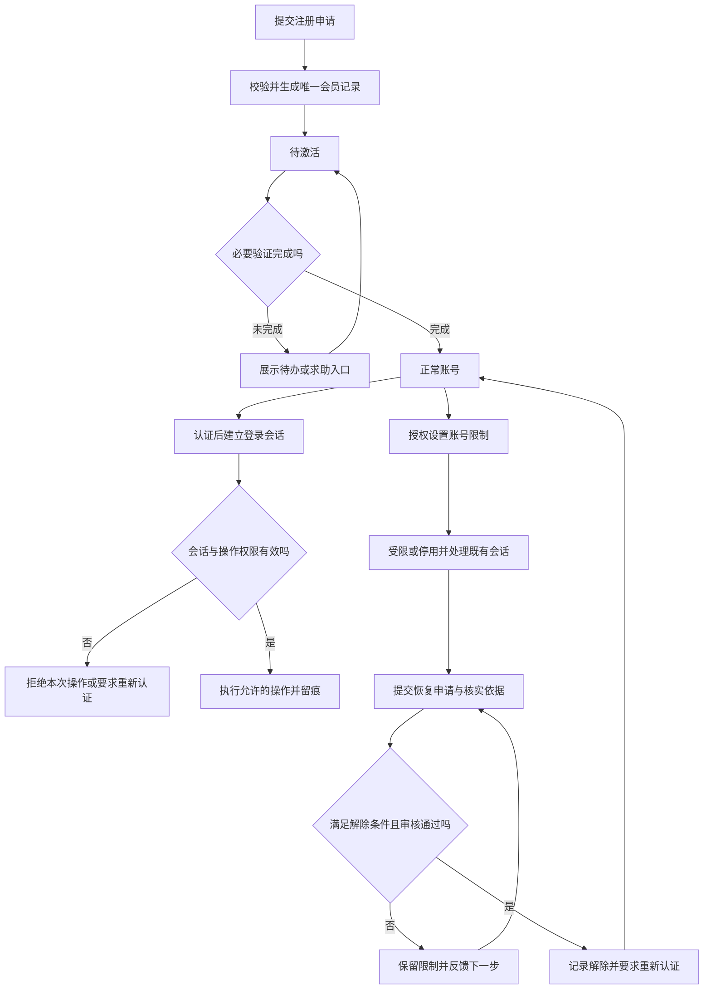

## 一句话解释

会员账号是识别用户和关联业务记录的身份载体；账号状态决定哪些操作可以进行，验证状态、登录会话和角色权限则分别描述证明材料、当前访问和授权范围，不能混用一个“正常／异常”标记。

本文采用虚构教学模型，不连接真实注册、身份认证或账号管理系统。状态名称、审核材料、保留期限和恢复条件需要按项目规则及适用要求另行确定。

## 适合谁看

- 产品与设计：定义注册、登录、个人资料与受限页面的反馈。
- 客服与运营：区分登录失败、资料待核实和账号限制，明确可查询与可处理的范围。
- 技术与测试：核对状态转换、会话失效、重复提交及服务端授权。

## 学习路径

1. 先读[会员、代理与平台的关系](/articles/member-agent-platform)，区分账号身份和业务归属。
2. 用本文的概念表、状态表和流程图梳理正常、受限与恢复路径。
3. 对照[后台模块](/articles/admin-modules)及[风险规则基础](/articles/risk-rule-basic)，明确查询、审核、处理权限。
4. 使用[会员账号状态评审表](/templates/member-account-review)逐项评审，再读[代理系统专题](/articles/agent-system-design)核对关系变更。

## 概念与边界

| 概念 | 回答什么 | 本例约定 |
|---|---|---|
| 会员标识 | 这是谁 | 使用不可随意变更的内部 ID 关联业务，手机号不是唯一业务主键 |
| 账号状态 | 可以做哪些事 | 待激活、正常、受限、停用、已关闭分别定义允许动作 |
| 验证状态 | 哪项资料核实到哪一步 | 按资料类型分别记录未提交、审核中、通过、需补充，不等于账号状态 |
| 登录会话 | 这次访问是否仍有效 | 会话过期需要重新认证，不直接把账号改为停用 |
| 角色权限 | 可以看什么、操作什么 | 普通会员、客服、审核人员按职责授权，后台权限由服务端校验 |
| 会员归属 | 属于哪一合作关系 | 与账号状态独立记录；停用账号不自动改写历史代理归属 |

账号受限可以只影响资料变更或某项业务，也可以影响登录，必须明确限制范围，不能只给一个红色状态。账号停用不等于资金冻结；如果确实存在资金限制，需在钱包中保留独立依据、关联记录与处理状态，见[钱包、支付与对账专题](/articles/wallet-payment-reconciliation)。

## 状态与处理

以下是示例转换，具体项目应逐项约定触发条件、操作者和用户可见内容。

| 账号状态 | 进入条件 | 用户反馈 | 后台动作与恢复条件 |
|---|---|---|---|
| 待激活 | 注册已创建，必要激活步骤尚未完成 | 说明还需完成什么、如何重试或求助 | 查询注册记录；验证通过后激活。不得靠重复注册创建多个身份 |
| 正常 | 激活完成，且无适用限制 | 展示可用功能；关键动作仍需独立授权 | 按权限处理请求，保留敏感资料变更日志 |
| 受限 | 经规则或授权审核确定某项限制 | 说明受影响的功能、可执行下一步和申诉入口，不展示内部识别细节 | 记录范围、依据、期限、处理人；满足解除条件且复核通过后恢复 |
| 停用 | 授权流程决定暂停账号访问 | 提示暂不可访问及可用的支持渠道 | 阻断相应访问并处理既有会话；批准恢复后重新认证 |
| 已关闭 | 关闭申请或管理决定通过，并完成关联事项核对 | 说明已关闭和支持渠道，避免承诺可以直接恢复 | 按明确规则处理资料及记录；本例不提供一键恢复，历史订单与审计不能随意删除 |

### 注册、登录与资料变更的页面反馈

| 场景 | 用户应看到什么 | 验收重点 |
|---|---|---|
| 注册提交中或超时 | 正在确认注册结果，可查询或按指引重试 | 防重复提交；超时不直接认定创建失败 |
| 登录凭据不正确 | 使用一致、清楚的认证失败说明和找回入口 | 不通过不同错误提示暴露账号是否存在，日志不记录明文凭据 |
| 会话过期 | 明确要求重新认证，提供返回任务的合理路径 | 账号状态保持原值；旧会话不能继续完成敏感操作 |
| 提交联系方式变更 | 显示申请状态，核实完成前保留原生效资料 | 验证新资料与变更授权分别核对；失败不出现“界面已改、实际未改” |
| 受限账号申请恢复 | 显示审核中、需补充或已处理，不承诺即刻恢复 | 解除条件与审核结果可追溯；客服不能越权直接解除 |

## 流程图

图中“拒绝本次操作”不意味着自动停用账号。账号状态、会话有效性和操作权限需要在提交时重新核对，不能只在页面打开时检查一次。

## 虚构示例

会员 U-DEMO-021 的账号原为正常，已登记联系方式，本例不展示真实联系方式、证件或凭据。以下时间均为 Asia/Shanghai 2026-10-23，编号、时间和操作均为虚构。

| 时间 | 事件 | 生效结果与证据 |
|---|---|---|
| 09:00 | 提交联系方式变更申请 CHG-DEMO-01 | 申请审核中，原资料继续生效，账号仍正常 |
| 09:10 | 授权人员记录限制 CASE-DEMO-01 | 本例限制资料变更，原申请暂停；限制范围和依据可追溯，不自动冻结资金 |
| 09:20 | 客服收到恢复申请 | 客服补充核实资料，不能直接改账号状态 |
| 09:35 | 独立审核人员通过恢复申请 | 记录解除限制；原联系方式申请不自动通过，需重新核对后处理 |
| 09:40 | 用户重新认证 | 按当前状态重新判断可用操作；敏感变更仍走单独验证 |

验收时分别查看账号记录、资料变更申请、限制工单与会话处理记录。不要把“账号恢复成功”误写成“资料变更审核通过”，也不要因恢复而重放此前未完成的敏感操作。

## 异常场景

| 情况 | 先核实什么 | 处理与关闭证据 |
|---|---|---|
| 注册结果未知或重复提交 | 唯一请求、已有会员记录及实际创建结果 | 返回原结果或进入核实，避免创建重复身份；记录请求与会员映射 |
| 变更资料被另一申请占用 | 当前生效资料、申请版本及验证结果 | 告知需核实，保留原资料；不能通过重复点提交覆盖他人资料 |
| 停用后旧页面仍可操作 | 会话有效性、权限缓存与服务端状态 | 服务端拒绝受限动作，提示重新认证或联系支持，保留拒绝日志 |
| 恢复与新限制同时发生 | 当前状态版本、全部未解除限制及审批顺序 | 恢复只解除已批准的那一项，不覆盖新限制；保存冲突与重试结果 |
| 联系方式失效无法自助核实 | 替代核实流程和授权角色 | 转人工核实，不要求在公开聊天发送证件或密码；保留受控工单证据 |
| 关闭账号仍有未结事项 | 未决订单、争议、归属与资料保留要求 | 进入核对流程，不删除订单或替代资金处理；按规则完成后记录关闭依据 |

## 评审检查清单

- [ ] 账号状态、验证状态、登录会话、会员归属和后台权限分别定义。
- [ ] 每个状态具有进入条件、影响范围、用户提示、允许动作和恢复条件。
- [ ] 注册重复请求、认证失败与会话过期有清楚反馈，错误提示不暴露敏感信息。
- [ ] 资料变更申请与当前生效资料分开，失败或受限不会留下半生效数据。
- [ ] 受限和停用覆盖既有会话与服务端操作校验，不只隐藏按钮。
- [ ] 限制与恢复具备原因、授权角色、审批、操作时间、关联工单及并发冲突处理。
- [ ] 恢复不自动批准资料变更、不重放敏感动作、不重写历史代理关系。
- [ ] 查询、审核、解除限制和导出遵循职责分离与最小可见范围。
- [ ] 关闭与资料保留规则明确，未决业务和历史审计记录有独立处置路径。

用[会员账号状态评审表](/templates/member-account-review)记录负责人、期望结果、实际结果和证据，再用[上线检查清单](/templates/launch-checklist)串联整体业务。

## 相关资料

- 术语：[账号状态](/glossary#account-status)、[验证状态](/glossary#verification-status)、[后台权限](/glossary#admin-permission)。
- 文章：[会员与代理关系](/articles/member-agent-platform)、[代理系统](/articles/agent-system-design)、[钱包对账](/articles/wallet-payment-reconciliation)。
- 模板：[账号状态评审表](/templates/member-account-review)、[风控规则评审表](/templates/risk-rule-review)。
- 页面参考：[后台优化案例](/cases/admin-optimization)用于学习角色查询与处理入口，不作为账号限制机制已实现的证据。

## 风险与注意事项

- 本文是业务教学方案，不规定具体身份认证、限制策略或法律保留期限；真实项目须核对适用要求与实际接口契约。
- 示例不包含真实身份、联系方式或凭据；页面、日志与导出应按角色脱敏，禁止记录明文密码和验证秘密。
- 账号恢复不替代风险复核、资金核对或资料变更审批；不同限制的解除条件分别判断。
- 业务状态与后台权限由服务端执行。界面示例和检查表不能证明实际鉴权、会话失效或审计已经实现。
