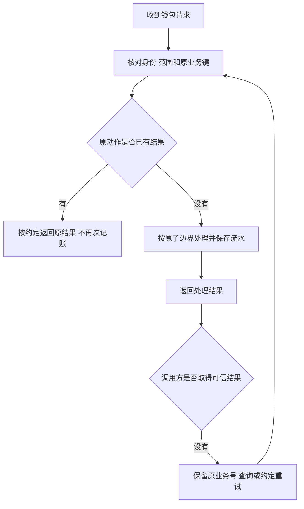

## 一句话解释

先区分三个层次：**中心或主钱包**描述平台账户与账本的位置；**Transfer／Seamless**描述与游戏服务怎样接入；**用户是否手动转账**描述页面体验。这三者不能直接画等号。本页保留原题和链接，用转账式与回调式两个示例模型说明职责。

## 适合谁看

适合需要核对钱包页面、接口分工和余额异常的产品、开发、运营与客服。本页金额、交易号和流程均为虚构说明，不连接真实游戏或支付。

## 先把名称说清楚

| 名称 | 本页如何使用 | 不能仅凭名称推出什么 |
|---|---|---|
| 中心钱包／平台主钱包 | 平台维护的主账户或账本层次 | 不代表一定要求用户手动转入转出 |
| 转账式 Transfer | 平台与场馆或聚合服务侧账户之间存在转入转出的接入模型 | 自动执行转账也可能做成页面上无需手动操作 |
| 回调式 Seamless | 游戏服务请求平台钱包查询或处理有效业务动作的接入模型 | 不代表没有网络请求、事务处理或对账 |
| 页面上的“免转” | 用户体验中不需要手动转账 | 不足以确认后台一定采用某个厂商的Seamless接口 |

不同服务对术语的用法可能不同，接入前应把余额由谁维护、谁执行扣款与入账、怎样查询原交易写清楚，不能只填写一个模式名称。

## 两种模型的职责对照

下表是解释模型，不是所有厂商统一的接口清单。回调式是本页对Seamless交互方向的说明名称，实际端点与结果语义以服务文档为准。

| 对照项 | 转账式模型 | 回调式模型 |
|---|---|---|
| 余额在哪里 | 本例有平台主钱包与场馆侧账户 | 本例由平台钱包维护有效余额 |
| 平台调用什么 | 查询场馆余额、转入与转出等约定操作 | 提供被调用的钱包接口，并维护关联交易结果 |
| 游戏服务做什么 | 本例在其账户范围处理游戏交易 | 按约定请求余额、扣款、入账或更正 |
| 用户看见什么 | 可以有手动转账，也可以由平台自动承接 | 通常无须手动转账，但仍需清晰的等待与失败反馈 |
| 核对什么 | 转账业务号、两侧账户记录、明确结果与差异 | 原业务键、请求尝试、有效流水与关联结果 |
| 主要异常 | 转入或转出结果未知、两侧记录不一致 | 重复请求、乱序、处理超时或关联记录缺失 |

不能根据模式名称固定判断技术难度、成本或稳定性，也不能据此宣称一种方式必然更好。实际能力取决于接口约定、账本、幂等、查询与运行保障。

## 公开接口资料怎样支持这个区别

核对日期：2026-10-27。以下是Hub88的官方接口说明，仅用于说明接入职责，不代表本知识库或案例已完成该厂商接入。

- [Operator API Overview](https://docs.hub88.io/developer-docs/operator-api-reference/operator-api-overview)：Wallet API由运营方提供相应端点，供Hub88调用；文档也说明重复交易的处理要求。
- [TransferWallet API](https://docs.hub88.io/developer-docs/operator-api-reference/transferwallet-api)：提供请求开通的转入、转出和余额查询能力。
- [Demo and Real Gameplay](https://docs.hub88.io/developer-docs/operator-api-reference/operator-api-overview/demo-and-real-gameplay)：分别说明Seamless和Transfer场景中的游戏动作与余额更新责任。

以上资料支持“先核对调用方向与账户责任”的方法；它们不是所有供应商共用的命名或接口标准。

## 虚构金额示例：转账不是新增资金

本例约定币种为示例币DEMO，不计费用、不发生游戏交易，期初平台100.00、场馆0.00。跨账户合计只用于本例核对，不等于用户任一时点都能从同一入口取用全部余额。

| 阶段 | 平台主钱包 | 场馆账户 | 本例合计 | 核对依据 |
|---|---:|---:|---:|---|
| 期初 | 100.00 | 0.00 | 100.00 | 两侧期初记录 |
| 原转入30.00明确完成 | 70.00 | 30.00 | 100.00 | 同一转账号关联两侧记录 |
| 原转出10.00明确完成 | 80.00 | 20.00 | 100.00 | 原转出结果与有效流水 |

原转入号为 `TR-DEMO-001`。若转入响应超时，不能先宣告完成，也不能换一个业务号再转30.00。先按原号查询并核对两侧记录，取得可信结果后再按约定处理；未知阶段的可用、冻结或待确认余额取决于实际账本设计，不在这里假定。

## 虚构金额示例：重复请求不能重复记账

回调式示例由平台维护余额，期初100.00。原扣款业务 `SW-DEMO-001` 明确处理10.00后余额90.00；收到同一业务的重复请求仍为90.00，不变成80.00。独立入账业务 `SW-DEMO-002` 明确处理15.00后余额105.00。

这里的15.00就是本例入账金额，不代表所有接口都把某个“赢额”字段定义成同一种毛额或净额。是否包含本金、如何关联扣款、如何更正，应核对具体契约。

流程图是解释幂等边界的模型，不能替代实际接口协议。[接口幂等与补偿](/articles/api-idempotency-compensation)说明业务键、请求号、原子处理与更正记录的区别。

## 超时和余额差异先看哪几份记录

| 情况 | 先查什么 | 避免什么动作 |
|---|---|---|
| 转入或转出超时 | 原转账号、外部查询、两侧流水与金额 | 换新业务号重复转账 |
| 重复扣款通知 | 原业务键、已保存结果与有效流水 | 按每次请求再次扣款 |
| 余额展示不一致 | 币种、可用／冻结口径、查询时间、有效流水 | 把不同口径直接相加或覆盖账本 |
| 入账先到或关联缺失 | 原交易关联和服务的乱序约定 | 凭到达顺序自行重建业务结果 |
| 人工调整 | 差异依据、授权、独立流水与复核 | 直接修改余额字段消除差异 |

相关操作示例见[充值对账](/articles/wallet-payment-reconciliation#reconciliation-case)、[提现未知结果](/articles/wallet-payment-reconciliation#withdrawal-case)；[厂商API对接](/articles/game-provider-api#先确认钱包模式再分配接口责任)解释接口协作。它们都是本知识库的虚构说明，不是对Hub88真实交易的演示。

## 对照页面与后台材料

[后台财务与客服导览](/cases/admin-optimization#admin-role-tour)可用来观察余额、列表、详情和关联记录的呈现位置。界面截图不证明其采用哪一种钱包接入；要判断真实模式仍需接口与账本证据。

可用[钱包支付与对账检查表](/templates/wallet-reconciliation-checklist)记录本项目的账户责任、币种精度、原交易查询和异常复核条件。

## 风险与注意事项

- 页面免转、共享一个余额显示和Seamless接口不是同一个判断。
- 转账式也需要防重复、并发控制、结果查询与对账；不能视为天然简单。
- 超时不是明确失败。退款、释放或补偿需要原结果、授权和可追溯记录。
- 本例未引入手续费、汇率、冻结与游戏损益，不能直接套用为真实生产账务方案。
