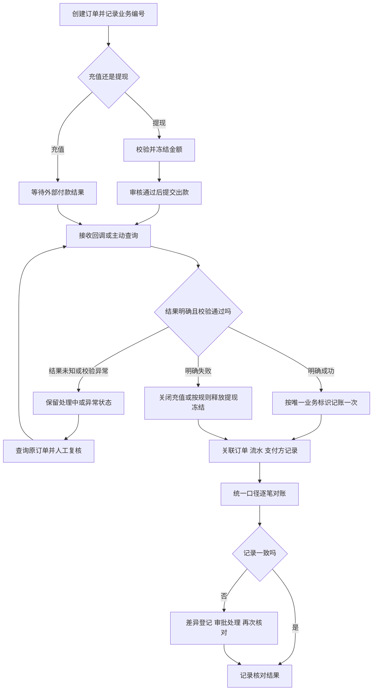

## 一句话解释

钱包回答“余额怎样变化”，支付订单回答“外部处理到哪一步”，对账回答“订单、资金流水和支付方记录能否逐笔对应”。三者通过关联编号衔接，不能只看一个成功标记或汇总金额。

本文是产品与验收教学示例。所有编号、金额、时间和状态均为虚构，不连接真实支付或交易；具体状态名称应以项目约定为准。

## 按这条路径学习

1. 先读[中心钱包与免转钱包](/articles/wallet-center-vs-seamless)，认识钱包边界。
2. 对照[支付通道基础](/articles/payment-channel-basic)，区分订单、外部处理和入账。
3. 阅读本文的流程、状态与对账示例，再[操作钱包流水原型](/design/prototypes#wallet-ledger-prototype)。
4. 用[数据报表指标](/articles/data-report-metrics)确认统计口径，最后使用[钱包支付与对账检查表](/templates/wallet-reconciliation-checklist)验收。

## 先分清余额、订单与流水

| 对象 | 回答的问题 | 至少需要哪些信息 |
|---|---|---|
| 可用余额 | 当前还能使用多少 | 用户、币种、金额、更新时间 |
| 冻结金额 | 哪些资金正在等待处理 | 原因、关联业务、冻结与释放记录 |
| 支付订单 | 这次充值或提现进行到哪一步 | 平台订单号、方向、金额、币种、状态、支付方编号 |
| 资金流水 | 哪次业务实际改变了资金 | 流水号、关联订单、变动方向、金额、前后余额、记账时间 |
| 对账差异 | 哪些记录仍不一致 | 差异类型、核对口径、证据、责任人、处理状态 |

充值订单“外部支付成功”与“钱包入账成功”应分别记录。重复回调可以有多条接收日志，但同一入账业务只能产生一次有效入账。冻结、解冻和余额变动的表示方式应在账本模型中明确，不把冻结误算成另一笔支出。

本文的“资金流水”指账本中的收支变动记录，与运营报表中的“投注流水”（投注金额汇总）不是同一口径。

## 从订单到对账的流程

流程中的“校验”包括来源、订单、金额、币种和允许的状态转换。超时只表示没有及时取得结果，不足以证明交易失败；确认原订单状态前，不直接发起一笔新支付。

## 充值状态与用户反馈

| 状态示例 | 钱包动作 | 用户看到什么 | 后台需要做什么 |
|---|---|---|---|
| 待付款 | 不增加余额 | 等待付款，可查询订单 | 记录有效期及支付方订单号 |
| 支付结果确认中 | 不重复入账 | 正在确认，请查看订单进度 | 主动查询，保留回调与错误日志 |
| 支付成功、入账异常 | 不显示为已到账 | 付款已确认，到账处理中 | 生成待处理差异，查账本后决定补偿 |
| 已入账 | 写入一次有效入账流水 | 展示到账金额及关联订单 | 可追溯到支付凭证和流水 |
| 明确失败或关闭 | 不增加余额 | 失败原因或已关闭提示 | 保存外部确认依据，处理迟到结果 |

### 虚构例子：两次成功回调，只入账一次

充值订单 DP-DEMO-001 金额为 CNY 500.00，入账前可用余额为 CNY 1,260.00。首次成功结果校验通过后，生成关联该订单的有效入账流水，余额变为 CNY 1,760.00。

第二次收到相同业务的成功回调时，保留接收日志并返回既有处理结果，不再次加款。验收应核对“入账业务唯一、有效入账流水唯一、余额只增加 500.00”，而不是要求回调日志只有一条。并发、重复或乱序通知也需要遵守同一业务约束。

## 提现状态与冻结释放

| 状态示例 | 资金处理 | 操作与反馈 |
|---|---|---|
| 待审核 | 按产品规则冻结本次申请金额 | 告知审核中；审核角色查看原因与关联记录 |
| 已拒绝或合法撤销 | 按原冻结记录释放一次 | 展示结果及适合公开的原因，保留审核日志 |
| 出款处理中 | 继续保留冻结，不重复提交 | 展示查询入口，后台查询原出款单 |
| 出款成功 | 结转原冻结金额，记录实际支出 | 展示完成，关联支付方凭证与资金流水 |
| 明确出款失败 | 确认未出款后按规则释放冻结 | 展示失败结果，避免重复解冻或退款 |
| 出款结果未知 | 不按失败自动释放冻结 | 告知结果确认中，升级查询与复核 |

虚构例子：账面总额 CNY 1,000.00，申请提现 CNY 200.00 后，可用为 800.00、冻结为 200.00，总额仍为 1,000.00。若明确成功，则结转冻结，总额为 800.00、可用为 800.00、冻结为 0；不能再从可用余额扣除 200.00。若明确失败并满足释放条件，则可用恢复 1,000.00、冻结为 0。这里采用“总额＝可用＋冻结”的教学模型，真实项目应先统一账本定义。

## 如何逐笔对账

先约定核对范围，再匹配记录：

- 本例只核对 CNY，时间为 Asia/Shanghai 2026-10-22 00:00（含）至 2026-10-23 00:00（不含）。区分订单创建、支付完成和账本记账时间，不用不同时间口径直接判错。
- 使用平台订单号与支付方编号的明确映射匹配；不能只用用户、金额和相近时间猜测同一笔交易。
- 分开核对充值和提现，明确手续费、毛额、净额、金额精度与币种。汇总只帮助发现差异，不能代替明细。
- 将处理中、跨日、明确失败和已完成分开统计，保留本次核对的数据版本与时间。

### 虚构对账明细

| 订单 | 外部记录 | 平台记录 | 判断与下一步 |
|---|---|---|---|
| DP-DEMO-001 | 收款成功 500.00 | 有效入账 500.00 | 金额、币种与编号一致，记录核对通过 |
| DP-DEMO-002 | 收款成功 300.00 | 尚无入账流水 | 登记缺账，查回调与记账结果，批准后补偿一次 |
| WD-DEMO-003 | 出款结果未知 | 冻结 200.00，尚无实际支出 | 继续查询原订单；不能把冻结算作已出款，也不能立即释放 |
| DP-DEMO-004 | 收款成功 100.00 | 两条有效入账各 100.00 | 疑似重复记账，暂停自动处理并升级复核，保留原始记录 |

差异处理建议采用“待核实 → 已确认 → 待审批 → 已处理 → 复核关闭”，每步记录证据与操作者。关闭前重新核对原订单、账本和外部结果。不得通过删除原流水或直接改余额来抹平差异；更正应有可追溯的冲正或调整记录。

## 失败、重试与补偿怎么区分

| 情况 | 先核实什么 | 合理动作 | 验收重点 |
|---|---|---|---|
| 请求超时 | 原订单是否被外部接收 | 查询原请求结果，保持处理中 | 不创建重复出款 |
| 回调重复或乱序 | 是否已完成同一业务记账 | 返回已处理结果，记录重复或异常通知 | 已确认的终态不被旧通知倒退 |
| 金额或币种不符 | 原订单、来源与外部凭证 | 隔离异常，人工核实 | 不自动入账或放行 |
| 外部成功、内部未记账 | 账本是否已有记录，是否只是展示延迟 | 先查账本，授权后按同一业务标识补偿 | 并发补偿仍只记账一次 |
| 跨日记录不一致 | 完成时间、时区、批次与数据延迟 | 归入对应核对周期并保留差异记录 | 不把跨日误作丢单 |

技术重试是再次处理同一请求；业务补偿是在确认业务事实后补齐缺失动作。两者都需要唯一业务标识、次数限制和升级处理条件，不等于无限重发或人工随意加减余额。

## 亲手检查一个页面

打开[钱包流水原型](/design/prototypes#wallet-ledger-prototype)，依次查看“流水摘要”“处理记录”“技术追溯”：核对金额与前后余额，确认订单号、回调编号和幂等标识可以串起同一笔记录。再点“人工调整”检查确认提示，选择“取消”，观察金额保持不变。

该原型是另一个独立的虚构界面示例，编号与本文不同，只用于学习信息展示和确认反馈，不能代替真实账本或审批系统验收。[后台优化案例](/cases/admin-optimization)可用于对照角色视角与异常入口的组织方式，不代表已经验证本文中的支付记账逻辑。

## 需求与验收检查清单

- [ ] 余额、可用、冻结、收入、支出的定义和精度明确。
- [ ] 平台订单、支付方编号、资金流水和回调日志可以关联。
- [ ] 充值与提现分别定义状态、允许转换、用户提示及后台动作。
- [ ] 重复、并发、乱序回调不会重复记账或使终态倒退。
- [ ] 超时、结果未知、明确失败采用不同处理方式。
- [ ] 提现冻结、结转和释放各自只影响一次，不重复扣款或退款。
- [ ] 对账统一币种、时区、时间字段、周期、手续费与数据版本。
- [ ] 缺账、重复、金额不符、跨日差异都有明细、责任人和关闭证据。
- [ ] 查询、审核、调整、导出权限分开，敏感信息按角色展示。
- [ ] 人工补偿具有依据、审批、操作日志和二次核对。

使用[可复制和下载的检查表](/templates/wallet-reconciliation-checklist)分配负责人；需要定义字段时对照[数据报表模板](/templates/data-report-spec)，上线前再走[上线检查清单](/templates/launch-checklist)。

## 风险与注意事项

- 本文描述一种教学模型，不构成特定支付服务的接口契约。字段、状态与手续费以正式文档和业务规则为准。
- 演示中的金额、账号和日志不得直接用于真实交易；测试使用隔离环境和脱敏数据。
- 人工改账、解冻或补偿不能替代权限隔离、审批和审计。结果不明时优先查证，不以猜测更改资金。
- 监控需要关注未决订单时长、差异数量、重复通知及补偿失败，并设置明确的响应与升级责任。
