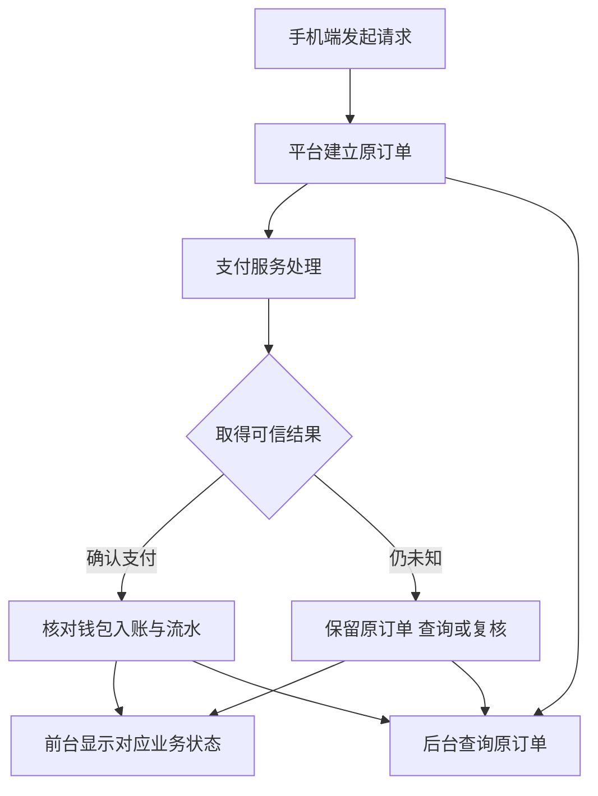

## 一句话解释

包网通常指使用供应方提供的平台软件与约定服务，组合品牌前台、会员、钱包、游戏接入和后台等能力。它是一种系统与服务的交付安排；包含哪些模块、谁负责运营和维护，需要逐项约定，不能只凭这个名称推定。

## 适合谁看

适合需要建立平台整体认识的新人，以及整理需求、评审界面、核对交付范围的产品、运营、开发和项目人员。本页模块图为生成示意，不表示某个真实供应商已经提供所有能力。

## 从三个层次理解平台

- **用户入口**：网站、手机页面、账户与服务入口，承接用户操作。
- **平台系统**：保存账号、订单、资金记录与业务规则，向前台和后台提供查询及操作能力。
- **外部服务**：游戏厂商、聚合商、支付与消息服务等，按照接口与服务约定协作。

日志、流水、权限和对账贯穿这些层次，不是外部服务独有的功能。用户在页面看见一个状态，也不能直接推定其他系统已经完成处理。

## 模块需要交付哪些东西

| 模块 | 用户或后台能看到什么 | 除页面以外还需核对 |
|---|---|---|
| 会员与账号 | 注册、登录、资料与状态 | 会话失效、角色权限、受限与恢复记录 |
| 钱包与支付 | 余额、充值、提现和流水 | 币种精度、订单与账本关联、未知结果、对账与调整 |
| 游戏接入 | 分类、可用状态、进入与退出 | 厂商账号、接口职责、维护反馈、交易与结果查询 |
| 代理与关系 | 会员归属、层级、结算记录 | 生效区间、规则版本、复核与更正记录 |
| 内容与活动 | 公告、帮助、活动规则 | 审核、语言与站点范围、有效期、生效版本 |
| 后台与数据 | 列表、详情、报表、操作 | 数据范围、指标定义、导出脱敏、审批与审计 |
| 运维与支持 | 故障反馈和服务进度 | 监控、备份、恢复验证、联系人和处理边界 |

这张表用于确认范围，不是统一的供应商能力清单。某些模块可能由不同服务方实现，也可能由客户团队自行维护。

## 示例分工与责任边界

以下是一个虚构项目的责任划分，实际分工以项目约定为准。

| 参与方 | 本例负责什么 | 交接时应留下什么 |
|---|---|---|
| 项目业务方 | 确认需求、角色、规则和内容，判断是否满足验收条件 | 需求版本、规则口径、负责人和确认记录 |
| 平台系统方 | 约定模块的软件实现、配置、接口适配与系统支持 | 版本说明、配置范围、接口映射、运行与故障记录 |
| 游戏或聚合服务方 | 提供约定的目录、启动与交易接口及结果信息 | 接入文档、业务编号、状态解释、查询与复核途径 |
| 支付服务方 | 执行约定的支付请求并提供状态与对账记录 | 原支付编号、结果依据、费用与对账口径 |
| 内容、客服与运维人员 | 在授权范围处理内容、用户问题和运行事件 | 审核记录、工单、时间线、处理与恢复证据 |

不能把“接口由供应商提供”理解成“平台不需要核对结果”。页面提示、内部账本与外部回执之间，仍需要明确谁负责关联、复核和关闭差异。

## 一笔充值怎样穿过多个模块

虚构记录 `WL-DEMO-001`：用户在手机端发起充值，平台建立订单，支付服务返回处理状态，钱包服务核对有效结果后记录入账，客服通过同一订单号查看进度。页面只是这条业务链的入口和反馈。

支付确认与钱包入账是不同证据。完整的虚构记录可在[钱包对账演示](/articles/wallet-payment-reconciliation#reconciliation-case)中查看；本页没有接入真实支付。

## 从需求走到可核对的交付

1. **确定范围**：站点、语言、币种、角色、模块、接口与不包含的事项。
2. **明确责任**：谁配置、谁审核、谁查询、谁处理异常，哪些服务另有约定。
3. **交付材料**：界面和可操作流程、配置说明、字段与状态定义、接口及版本资料。
4. **核对证据**：正常流程、失败、未知、权限不足、重复请求和返回路径分别留下记录。
5. **交接运行**：说明监控、备份、问题反馈、版本更新与回退的责任和入口。

[包网项目需求表](/templates/white-label-requirement-form)可记录范围；[需求与版本验收](/articles/requirements-release-acceptance#验收矩阵)用于把描述转成可核对的条件。

## 对照现有界面材料

[包网官网案例](/cases/white-label-official#official-responsive-comparison)展示服务说明、页面结构和咨询入口的桌面／手机实际页面截图，可以观察信息怎样组织。[后台案例](/cases/admin-optimization#admin-role-tour)展示角色、列表和详情的演示界面。两类材料说明不同层次，不证明整套真实业务系统已经验收。

继续阅读[平台如何运转](/articles/how-gambling-platform-works)，可把前台动作对应到后台记录；[钱包模式对照](/articles/wallet-center-vs-seamless)进一步区分账户层次与接入方式。

## 风险与注意事项

- 名称相同不表示交付范围相同，功能、数据访问、源稿或源码、支持与升级范围应分别确认。
- 不根据页面是否能打开推定接口、权限、账务与故障恢复均已完成。
- 系统方、游戏服务、支付服务和项目人员的责任不能仅以一个“售后”入口概括。
- 以现有材料能证明的能力为准；本页没有提供真实经营数据或收益结论。
